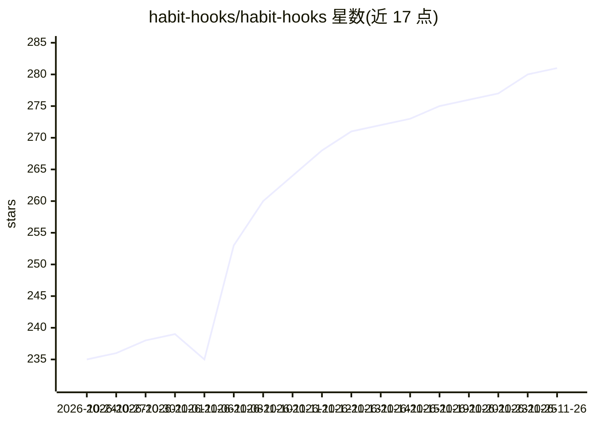

# habit-hooks/habit-hooks

⭐ 281 · Python · MIT · 推送 2026-11-19 · [GitHub](https://github.com/habit-hooks/habit-hooks) · [官网](http://habit-hooks.com/) · 个人维护

**面向 AI 编码代理的代码坏味道检查器与教练式反馈工具**

以 Python 包分发的命令行质量检查工具：habit-sensors 运行 ruff/eslint/jscpd/pmd/rubocop 等检测器收集发现项，habit-mapper 将发现项按坏味道键归类并渲染对应的教练指南，通过退出码（0/1/2）区分发现项与工具故障，可接入 CI。设计动机来自 AI 编码代理只对裸指标会投机取巧的行为：以 linter 发现为线索、教练指南为动作，引导代理完成真实重构。支持 Python/TypeScript/PHP/Java/Ruby 语言插件（opt-in extras），按分支/文件/提交范围扫描，提供 backlog 冷藏机制。

## 筛选速览

| 维度 | 判定 | 备注 |
|---|---|---|
| AI 角色 | `ai-ecosystem` | LLM/agent 周边工具 |
| 许可风险 | `permissive` | MIT |
| 部署形态 | `library` | 以包/库形式分发 |
| 模型依赖 | — | README 未给出锁定关系 |
| 硬件要求 | — | 无带数字的原话,不猜 |
| 安装摩擦 | `low` | 无编译、无系统依赖或容器化 |
| 成熟度 | — | 结构信号不足 |

## 能力要点

- habit-sensors→habit-mapper 管道：检测器发现项统一翻译为工具无关的坏味道键
- 按坏味道渲染教练指南而非裸指标，引用第三方预注册实验数据（83.3% vs 17%）
- 五语言插件（python/typescript/php/java/ruby）+ 通用插件，检测器不捆绑、按项目安装
- habit-snooze 冷藏存量问题 + 触碰即恢复的棘轮机制，退出码三态适配 CI

## 适用场景

- 在 CI 中拦截 AI 代理提交的带坏味道代码并给出修改指引
- 存量代码库先冷藏 backlog，之后只暴露新增坏味道
- 统一 ruff/eslint/pmd/rubocop 多语言检测结果为一致坏味道报告

## 场景标签

`代码审查` · 领域:编码与开发

## 证据(README 行号)

> L17: - AI coding agents ignore long rule documents. A book's worth of coding advice in the context window makes
> L23: - Habit Hooks supplies the missing loop from outside. The linter finding is the cue; the coaching guide is
> L251: Two command-line tools joined by a Unix pipe, with a JSON array of **findings** flowing between them:

## 星数曲线

2026-10-24 235 → 2026-11-26 281（+46）

---
*卡片 v1 · prompt 1.4 · 生成 2026-11-25 · 置信度 mid · 依据 README sha `fd2a866f67c4` · [字段定义](../../DATASET.md)*
