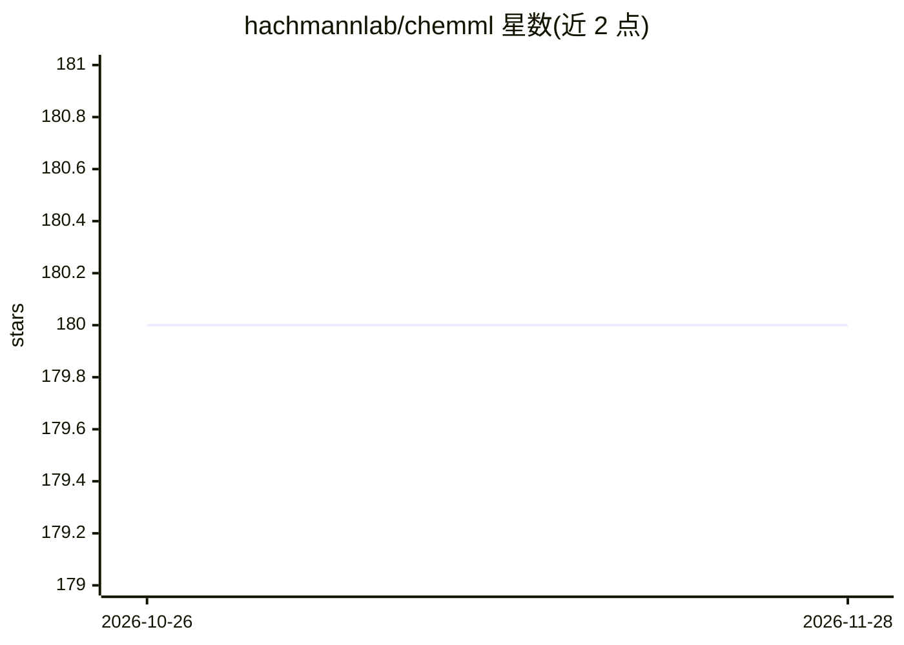

# hachmannlab/chemml

⭐ 180 · Python · BSD-3-Clause · 推送 2026-11-23 · [GitHub](https://github.com/hachmannlab/chemml) · [官网](https://hachmannlab.github.io/chemml) · 组织维护

**面向化学与材料科学的机器学习与信息学程序套件**

ChemML 是用于化学与材料数据分析、挖掘与建模的机器学习和信息学程序套件，以 Python 3 编写，采用模块化与面向对象设计，依赖 numpy、pandas、tensorflow、rdkit、torch、scikit-learn 等数据分析和 ML 库及领域专用库。提供 AutoML 筛选（可选 xgboost/lightgbm）、图卷积神经网络、XAI、Jupyter 封装界面等组件，由纽约州立大学布法罗分校团队维护，获 NSF 与 DOE 资助，以 3-Clause BSD 许可分发。

## 筛选速览

| 维度 | 判定 | 备注 |
|---|---|---|
| AI 角色 | `ai-native` | 本体是模型或模型工具 |
| 许可风险 | `permissive` | BSD-3-Clause |
| 部署形态 | `library` | 以包/库形式分发 |
| 模型依赖 | — | README 未给出锁定关系 |
| 硬件要求 | — | 无带数字的原话,不猜 |
| 安装摩擦 | `low` | 无编译、无系统依赖或容器化 |
| 成熟度 | — | 结构信号不足 |

## 能力要点

- 面向化学与材料数据的分析、挖掘与建模流程
- 模块化面向对象设计，集成 rdkit/openbabel 等领域专用库
- 含 autoML 筛选、图卷积神经网络与 XAI（shap/lime）组件
- 提供 ChemML Jupyter wrapper 图形化封装（可选依赖）

## 适用场景

- 对分子与材料数据集做机器学习建模
- 化学信息学中的描述符计算与特征分析
- 使用 AutoML 流程筛选候选模型
- 在 Jupyter 中以图形界面搭建化学 ML 工作流

## 场景标签

`科研工具` · 领域:学习与行业

## 证据(README 行号)

> L6: ChemML is a machine learning and informatics program suite for the analysis, mining, and modeling of chemical and ma
> L8: ChemML is developed in the Python 3 programming language and makes use of a host of data analysis and ML libraries, 
> L114:  University at Buffalo - The State University of New York (UB)

## 星数曲线

2026-10-26 180 → 2026-11-28 180（+0）

---
*卡片 v1 · prompt 1.4 · 生成 2026-11-26 · 置信度 high · 依据 README sha `e04b88d8206b` · [字段定义](../../DATASET.md)*
