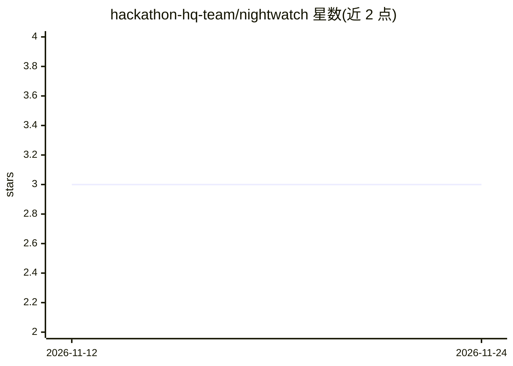

# hackathon-hq-team/nightwatch

⭐ 3 · Python · MIT · 推送 2026-10-30 · [GitHub](https://github.com/hackathon-hq-team/nightwatch) · [官网](https://youtu.be/VHniWXpS4NA) · 组织维护

**AI on-call agent：复现生产错误、验证修复、开 Draft PR**

接收 Sentry webhook 的生产错误告警，用 NVIDIA Nemotron 模型生成假设与 pytest 复现测试，在无网络、无密钥的 Docker 沙箱中隔离运行，仅当复现测试在坏版本失败、补丁通过全部测试后才输出 Draft PR；无法复现时输出诊断报告。由规则式验证器而非模型判定接受与否，限制 3 次补丁尝试与预算，从不自动合并或部署。为 Nebius × NVIDIA 黑客松作品，MIT 许可，仅支持 Python/pytest 栈，面向缺少专职 SRE 的小团队。

## 筛选速览

| 维度 | 判定 | 备注 |
|---|---|---|
| AI 角色 | `ai-native` | 本体是模型或模型工具 |
| 许可风险 | `permissive` | MIT |
| 部署形态 | `self-host` | docker 或自建部署 |
| 模型依赖 | — | README 未给出锁定关系 |
| 硬件要求 | — | 无带数字的原话,不猜 |
| 安装摩擦 | `low` | 无编译、无系统依赖或容器化 |
| 成熟度 | `idea` | |

## 能力要点

- 复现优先：未复现验证的修复不产出，测试文件哈希防止补丁改动测试
- 隔离沙箱运行不可信代码：无网络、无密钥、只读根文件系统与资源限制
- 隐藏测试独立验收与 17/17 场景结果，单次事件成本约 $0.012、耗时约 52 秒
- Tavily 网络搜索结果标记为 external/unverified 证据并逐页引用

## 适用场景

- 小团队夜间无人值守时自动排查 Sentry 生产告警
- 为修复提交附带复现测试与证据的 Draft PR
- 对无法复现的故障生成诚实诊断报告供人工处理

## 场景标签

`编码 Agent` · 领域:编码与开发

## 证据(README 行号)

> L5: **An open-source AI on-call engineer that never proposes a fix it has not reproduced and verified.**
> L7: Nightwatch receives a production error from Sentry, investigates it with NVIDIA Nemotron on
> L9: patch and verifies it. The on-call developer gets either a **Draft PR** with the fix, the

## 星数曲线

2026-11-12 3 → 2026-11-24 3（+0）

---
*卡片 v1 · prompt 1.4 · 生成 2026-11-22 · 置信度 high · 依据 README sha `664440470381` · [字段定义](../../DATASET.md)*
