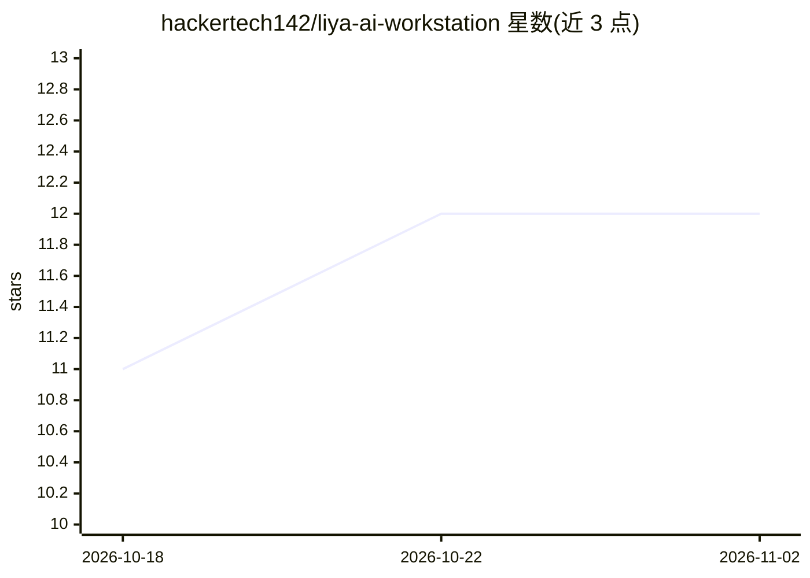

# hackertech142/liya-ai-workstation

⭐ 12 · JavaScript · MIT · 推送 2026-10-28 · [GitHub](https://github.com/hackertech142/liya-ai-workstation) · 个人维护

**桌面端 agentic AI 助手工作站：长期记忆+多智能体+本地视觉**

由个人开发者构建的桌面级 AI 助手与工作站：React 19 前端 + Express 后端 + Python ONNX 视觉管线。功能包括基于 Mem0 的长期向量记忆（云端 API + 本地回退）、可执行 HTML/CSS/JS 与图表地图的交互 Canvas、通过 inswapper_128.onnx 与 buffalo_l 实现的本地 FaceSwap、多子智能体 Blackboard 协作、Edge 神经 TTS（印度口音）语音合成，以及天气/新闻/汇率等 Mini 应用。模型接入需配置 Ollama Cloud API key，视觉部分 100% 本地运行。从源码克隆安装，需 Node.js v20+、Python 3.10+、FFmpeg。

## 筛选速览

| 维度 | 判定 | 备注 |
|---|---|---|
| AI 角色 | `ai-native` | 本体是模型或模型工具 |
| 许可风险 | `permissive` | MIT |
| 部署形态 | `None` |  |
| 模型依赖 | local-ok | 支持本地模型 |
| 硬件要求 | — | 无带数字的原话,不猜 |
| 安装摩擦 | `medium` | 含编译或系统依赖之一 |
| 成熟度 | — | 结构信号不足 |

## 能力要点

- Mem0 认知向量记忆，跨会话保留上下文与偏好
- 本地 ONNX FaceSwap（图片与多线程视频），零云端依赖
- 多子智能体（Coder/Academic/Terminal）Blackboard 协作编排
- Canvas 内实时执行 HTML/CSS/JS、Recharts 图表与 Leaflet 地图

## 适用场景

- 作为带长期记忆的个人桌面 AI 助手使用
- 在本地私密完成图片/视频换脸与计算机视觉任务
- 通过多智能体协作拆解执行编程、研究等复杂任务

## 场景标签

`AI 助手` `多智能体` `Agent 记忆` · 领域:Agent 开发

## 证据(README 行号)

> L20: **LIYA (Neural Intelligent Yield Assistant)** is an advanced agentic desktop workstation and personal digital assis
> L36:  🗣️ Ultra-Fast Neural Speech

## 星数曲线

2026-10-18 11 → 2026-11-02 12（+1）

---
*卡片 v1 · prompt 1.4 · 生成 2026-11-01 · 置信度 high · 依据 README sha `43ee7fdda5be` · [字段定义](../../DATASET.md)*
