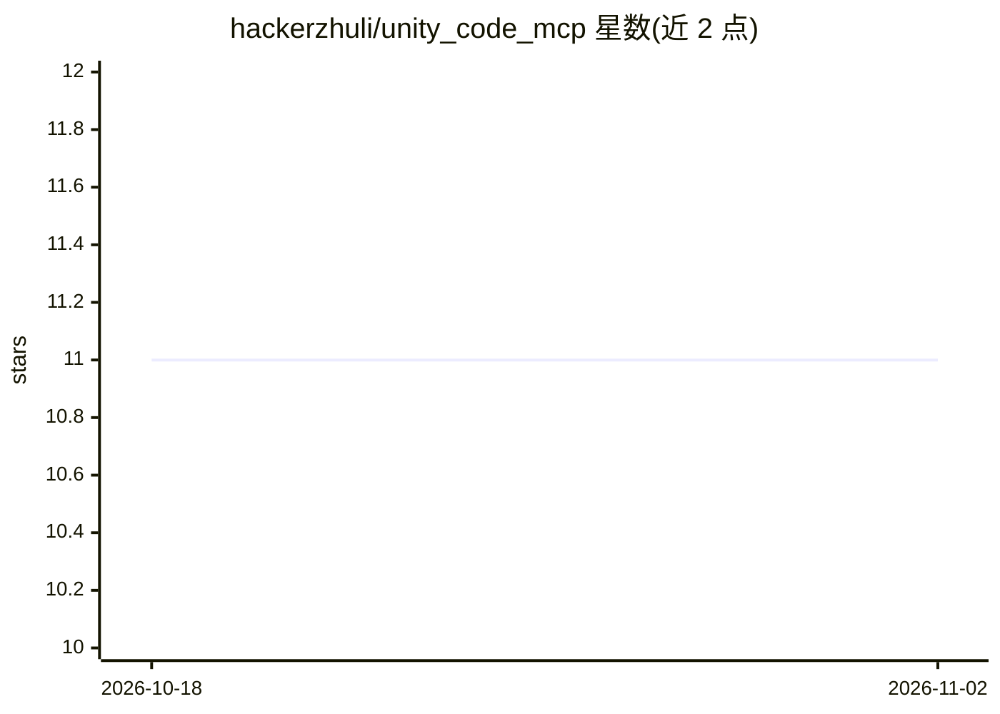

# hackerzhuli/unity_code_mcp

⭐ 11 · Rust · MIT · 推送 2026-08-02 · [GitHub](https://github.com/hackerzhuli/unity_code_mcp) · [官网](https://unitycode.hackerzhuli.com/en/docs/mcp/) · 个人维护

**让 AI agent 自主编写 Unity 代码的 MCP 服务器**

用 Rust 编写的 Model Context Protocol（MCP）服务器，向 AI agent 提供两个工具：触发 Unity 编译并返回错误日志的 Asset Database Refresh，以及支持 EditMode/PlayMode 的测试执行，使 agent 能自主完成写码、编译、修复、测试的循环。与 Unity Editor 通过 UDP 通信，编译为无运行时依赖的单二进制。要求 Unity 6.0 及以上并启用 Visual Studio Code Editor 包；预编译二进制仅提供 Windows，其他平台需自行编译，维护者仅测试 Windows。

## 筛选速览

| 维度 | 判定 | 备注 |
|---|---|---|
| AI 角色 | `ai-ecosystem` | LLM/agent 周边工具 |
| 许可风险 | `permissive` | MIT |
| 部署形态 | `desktop` | 安装包/桌面程序 |
| 模型依赖 | — | README 未给出锁定关系 |
| 硬件要求 | — | 无带数字的原话,不猜 |
| 安装摩擦 | `medium` | 含编译或系统依赖之一 |
| 成熟度 | — | 结构信号不足 |

## 能力要点

- 提供资产刷新（含编译错误回报）与测试执行两个 MCP 工具
- 与 Unity Editor 通过 UDP 通信，单二进制无运行时依赖
- 支持 EditMode 与 PlayMode 测试
- 通过 UNITY_PROJECT_PATH 环境变量或 MCP roots 能力发现 Unity 项目

## 适用场景

- 让 AI 编程助手在 Unity 项目中自主编译并修复错误
- 让 agent 运行 Unity 测试并根据失败堆栈改代码
- 在 Cursor、VS Code、Claude Desktop 中接入 Unity 开发工具

## 场景标签

`编码 Agent` · 领域:编码与开发

## 证据(README 行号)

> L4: Unity Code MCP is a coding focused Model Context Protocol (MCP) server that enables AI agents to write Unity code au
> L8: Unity Code MCP is a high-performance, coding-focused MCP server built in Rust. It handles Unity's compilation cycles
> L22: Unity Code MCP provides 2 tools for autonomous code development:

## 星数曲线

2026-10-18 11 → 2026-11-02 11（+0）

---
*卡片 v1 · prompt 1.4 · 生成 2026-11-02 · 置信度 high · 依据 README sha `56f115e4c89c` · [字段定义](../../DATASET.md)*
