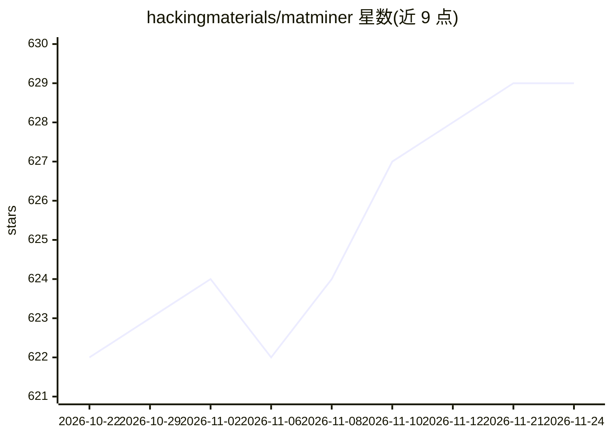

# hackingmaterials/matminer

⭐ 629 · HTML · NOASSERTION · 推送 2026-11-16 · [GitHub](https://github.com/hackingmaterials/matminer) · [官网](https://hackingmaterials.github.io/matminer/) · 组织维护

**材料科学领域的数据挖掘 Python 工具库**

matminer 是一个用于材料科学领域数据挖掘的 Python 库，支持 Python 3.11+。它帮助用户应用社区开发的方法与数据集，能力包括数据集访问、数据检索方法和特征化器（featurizers）；每个数据检索类与特征化器都提供 citations() 方法，输出 BibTeX 格式的原始文献引用，便于研究引用溯源。项目提供文档网站、示例仓库与支持论坛，仍在积极维护，部分相关包（automatminer、figrecipes）已归档。

## 筛选速览

| 维度 | 判定 | 备注 |
|---|---|---|
| AI 角色 | `ai-native` | 本体是模型或模型工具 |
| 许可风险 | `none` | NOASSERTION |
| 部署形态 | `None` |  |
| 模型依赖 | — | README 未给出锁定关系 |
| 硬件要求 | — | 无带数字的原话,不猜 |
| 安装摩擦 | `low` | 无编译、无系统依赖或容器化 |
| 成熟度 | — | 结构信号不足 |

## 能力要点

- 提供材料领域数据集访问与数据检索方法
- 为每个 featurizer 提供 citations() 函数，输出 BibTeX 引用
- 支持 Python 3.11+，含文档网站与示例仓库

## 适用场景

- 在材料科学研究中获取与使用社区数据集
- 为材料数据生成特征并溯源引用原始文献

## 场景标签

`科研工具` `数据分析` · 领域:效率与自动化

## 证据(README 行号)

> L6: matminer is a library for performing data mining in the field of materials science.
> L34: - If you use one or more **data retrieval methods**, check ``citations()`` method of the data retrieval class. This
> L35: - If you use one or more **featurizers**, please take advantage of the ```citations()``` function present for every

## 星数曲线



2026-10-22 622 → 2026-11-24 629（+7）


---
*卡片 v1 · prompt 1.4 · 生成 2026-11-24 · 置信度 mid · 依据 README sha `daa6f0b7dfde` · [字段定义](../../DATASET.md)*
