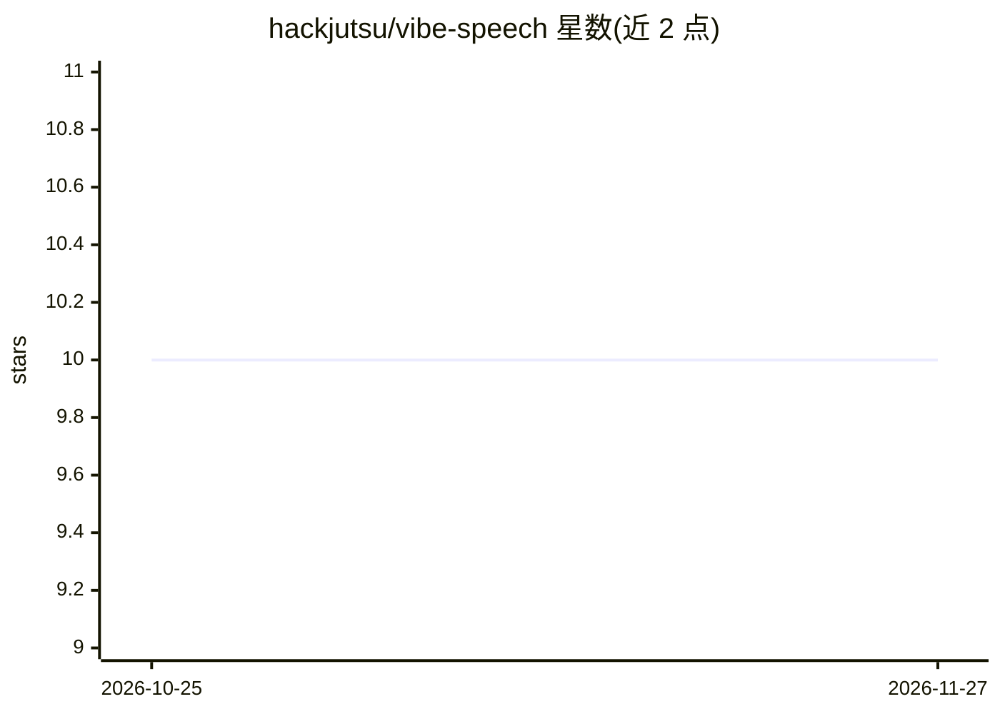

# hackjutsu/vibe-speech

⭐ 10 · Python · 推送 2025-12-08 · [GitHub](https://github.com/hackjutsu/vibe-speech) · 个人维护

**本地近实时语音助手：说话→Whisper 转录→本地 LLM 回答并朗读**

本地优先的语音助手：按住快捷键采集麦克风音频，松开后经 Faster-Whisper（默认 large-v3-turbo，可配置模型、beam、语言、初始提示）转录，文本可经可选的语法改写器（Ollama 或 llama.cpp）润色，再交给本地/Ollama LLM 助手生成带可配置人格的回复，通过 xsst2 朗读并用 pyautogui 自动输入。支持会话历史窗口、远程 /transcribe 转录卸载、DEBUG 日志与 doctor 自检。面向 macOS 与 Windows，Linux 依赖 pyautogui 可用。流式/部分输出尚未实现。

## 筛选速览

| 维度 | 判定 | 备注 |
|---|---|---|
| AI 角色 | `ai-native` | 本体是模型或模型工具 |
| 许可风险 | `none` | — |
| 部署形态 | `library` | 以包/库形式分发 |
| 模型依赖 | local-ok | 支持本地模型 |
| 硬件要求 | — | 无带数字的原话,不猜 |
| 安装摩擦 | `medium` | 含编译或系统依赖之一 |
| 成熟度 | `idea` | |

## 能力要点

- 按键说话（push-to-talk）：按住缓冲、松开后一次性转录并交给 LLM 助手
- Faster-Whisper 本地转录，可选远程 /transcribe 卸载
- 可选语法改写器（Ollama 或 llama.cpp）与可配置助手人格、历史窗口
- 回复经 xsst2 朗读，并可通过 pyautogui 自动键入

## 适用场景

- 用语音向本地 LLM 助手提问并听语音回答
- 在本地离线环境中做语音转文字与助手对话
- 通过快捷键口述文本自动输入到任意窗口

## 场景标签

`语音 Agent` `语音识别` `语音合成` · 领域:对话与助手

## 证据(README 行号)

> L3: Cross-platform, local-first voice helper that listens to the mic, runs Whisper locally, and feeds the transcript to 
> L9: - Assistant replies are generated by a local/Ollama LLM with a customizable personality and spoken through `xsst2`.

## 星数曲线

2026-10-25 10 → 2026-11-27 10（+0）

---
*卡片 v1 · prompt 1.4 · 生成 2026-11-19 · 置信度 high · 依据 README sha `5c52f9a4d3bb` · [字段定义](../../DATASET.md)*
