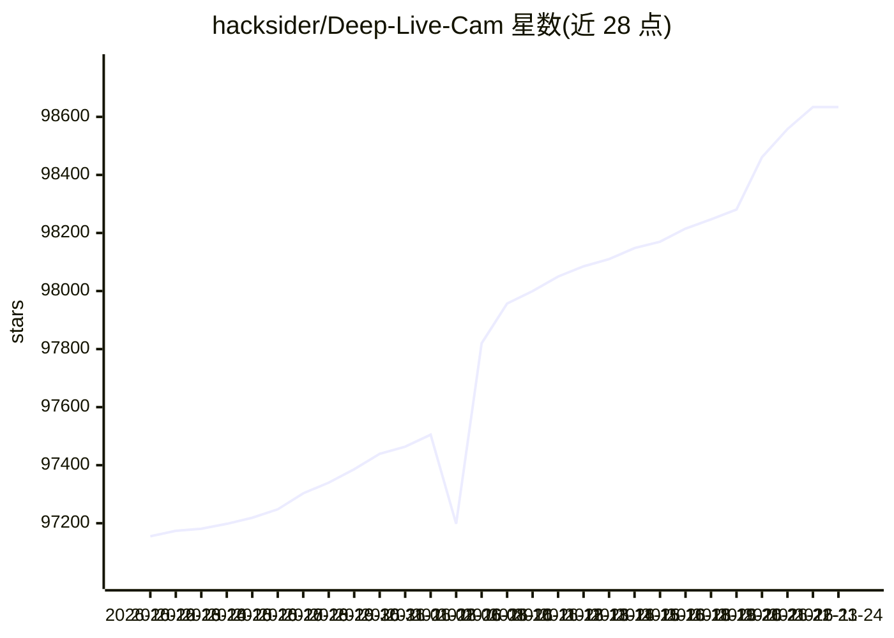

# hacksider/Deep-Live-Cam

⭐ 98,634 · Python · AGPL-3.0 · 推送 2026-11-08 · [GitHub](https://github.com/hacksider/Deep-Live-Cam) · [官网](https://deeplivecam.net/) · 组织维护

**单张图片实现实时换脸与一键视频 deepfake 的桌面工具**

基于 Python 的桌面应用：选择一张源人脸图后，可对图片/视频做换脸处理，或在摄像头模式下实时替换人脸（配 OBS 等推流工具使用）。功能包括 Mouth Mask 保留原口型、多主体同时人脸映射、命令行模式（标注为 Unmaintained）。手动安装需 Python 3.11-3.14、git、ffmpeg、下载约 300MB 的 ONNX 模型；另提供官网预编译的 Ultimate 付费版本。内置内容检查以阻止处理不当媒体，并要求使用者获得真人肖像授权。

## 筛选速览

| 维度 | 判定 | 备注 |
|---|---|---|
| AI 角色 | `ai-native` | 本体是模型或模型工具 |
| 许可风险 | `viral` | AGPL-3.0 |
| 部署形态 | `library` | 以包/库形式分发 |
| 模型依赖 | — | README 未给出锁定关系 |
| 硬件要求 | — | 无带数字的原话,不猜 |
| 安装摩擦 | `medium` | 含编译或系统依赖之一 |
| 成熟度 | — | 结构信号不足 |

## 动量与使用信号

- 维护:`active` — 距上次 push 8.1 天,年发版 9,82 位贡献者
- 涨星:近 1 天 **+13**(自 20261016 起算)
- 安装:pypi 包 `torch` 月下载 58,964,343
- 平台:WINDOWS · 协议:—

## 能力要点

- 单图驱动：选脸、选摄像头、点 Live 三步开启实时换脸
- Mouth Mask 保留原始口型，多主体人脸映射
- 支持 CUDA/CoreML/DirectML/OpenVINO 多种执行后端
- 内置不当媒体检查与伦理使用条款

## 适用场景

- 为创作内容给视频角色替换人脸
- 摄像头直播或视频通话中实时呈现替换后的人脸
- 批量处理图片/视频的换脸输出

## 场景标签

`图像视频处理` · 领域:感知与多模态

## 证据(README 行号)

> L3:  Real-time face swap and video deepfake with a single click and only a single image.
> L63: ## Features & Uses - Everything is in real-time
> L103: ## Installation (Manual)

## 星数曲线

2026-10-22 97,155 → 2026-11-24 98,634（+1,479）

---
*卡片 v1 · prompt 1.4 · 生成 2026-11-22 · 置信度 high · 依据 README sha `f0a10291abfb` · [字段定义](../../DATASET.md)*
