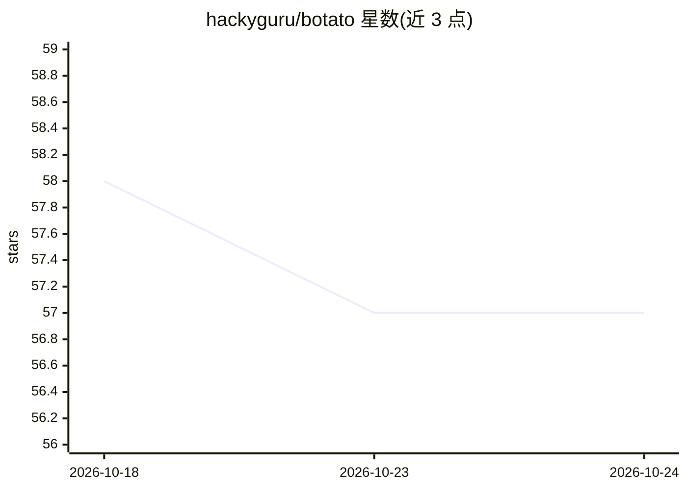

# hackyguru/botato

⭐ 57 · TypeScript · Apache-2.0 · 推送 2026-09-24 · [GitHub](https://github.com/hackyguru/botato) · [官网](https://botato.hackyguru.com) · 个人维护

**本地优先的常驻 AI bot 桌面应用：自管模型与机器人的聊天室**

运行在用户自己机器上的桌面应用：创建多个带持久记忆、日程和可选容器化 Linux 桌面的 AI bot，多 bot 与用户共享频道、互相应答，可在合盖后按计划继续执行任务，并通过 QUIC 点对点配对的手机 App 远程访问。引擎可换：默认 Claude Code CLI，也可用 Gemini CLI、166 个提供商的 5,559 个托管模型或本机 Ollama。连接器含 GitHub、Gmail、Calendar、Notion、Stripe，OAuth 令牌存系统钥匙串；备份为单加密文件。自述为 alpha（0.6.0），macOS/Linux 提供签名构建，bot 执行命令与消耗用户 API key 的风险由用户承担。

## 筛选速览

| 维度 | 判定 | 备注 |
|---|---|---|
| AI 角色 | `ai-native` | 本体是模型或模型工具 |
| 许可风险 | `permissive` | Apache-2.0 |
| 部署形态 | `library` | 以包/库形式分发 |
| 模型依赖 | local-ok | 支持本地模型 |
| 硬件要求 | — | 无带数字的原话,不猜 |
| 安装摩擦 | `medium` | 含编译或系统依赖之一 |
| 成熟度 | `idea` | |

## 能力要点

- 每个 bot 有独立磁盘会话、工作区与自维护记忆文件，跨重启保留
- 多 bot 共享频道互相应答，支持例会式 stand-up 例程与语音通话
- 引擎可中途切换：Claude Code / Gemini CLI / 托管模型 / 本机 Ollama
- 手机 App 经 QUIC + 公钥身份直连笔记本，无账号、无中转服务器

## 适用场景

- 在自己电脑上养多个有记忆、有日程的 AI 助手协同干活
- 让 bot 在夜间按计划执行任务并回报结果
- 从手机直接遥控家里电脑上的 bot 群

## 场景标签

`AI 助手` `多智能体` · 领域:Agent 开发

## 证据(README 行号)

> L5: 	Bots that live on your own machine. Each one gets a memory, a schedule and a computer of its own. Shut the lid and 
> L34: - **It runs on your computer.** No account to make, no server of ours, no telemetry. Your bots, files, keys and con
> L39: - **Bring your own model.** Claude Code by default, or the Gemini CLI, or any of 5,559 hosted models, or Ollama on 

## 星数曲线

2026-10-18 58 → 2026-10-24 57（-1）

---
*卡片 v1 · prompt 1.4 · 生成 2026-10-24 · 置信度 mid · 依据 README sha `eb2c9f5a3963` · [字段定义](../../DATASET.md)*
