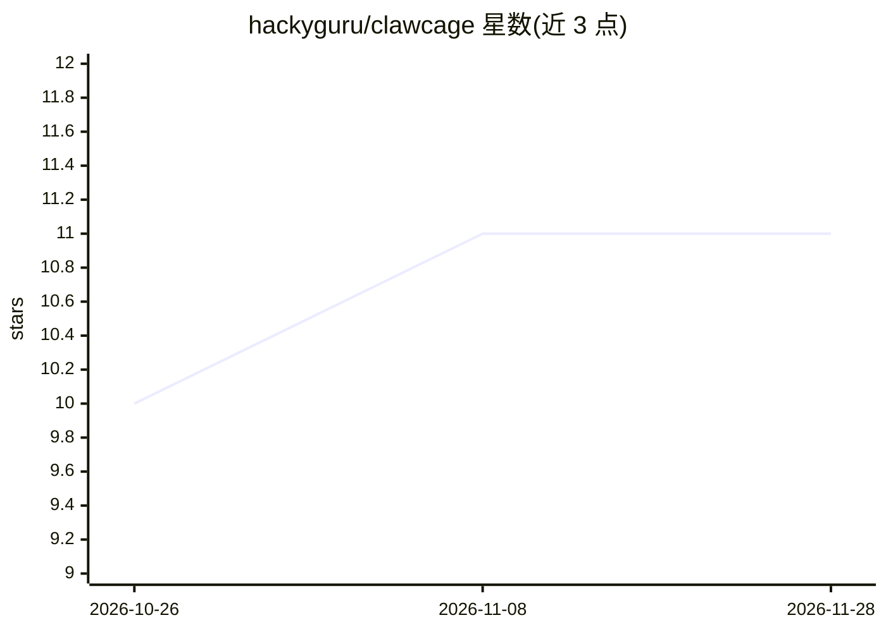

# hackyguru/clawcage

⭐ 11 · Rust · NOASSERTION · 推送 2026-04-20 · [GitHub](https://github.com/hackyguru/clawcage) · [官网](https://clawcage.hackyguru.com) · 个人维护

**在 Mac 上用隔离 Linux VM 沙箱运行 AI agent 的工具**

基于 Apple Virtualization.framework 的 macOS 原生应用（Rust + Tauri 2.0 + React），将 AI agent 隔离在无网络的 Linux VM 中运行：流量经 MITM 代理并按域名策略放行/拦截，API key 由宿主侧注入、不进入 VM，VM 默认无状态、每次启动格式化临时盘。提供 GUI 与 CLI 两种使用方式，内置 Blank/OpenClaw/Hermes 模板。要求 macOS 13+ 与 Apple Silicon，首次启动自动下载约 443 MB Linux rootfs。

## 筛选速览

| 维度 | 判定 | 备注 |
|---|---|---|
| AI 角色 | `ai-ecosystem` | LLM/agent 周边工具 |
| 许可风险 | `none` | NOASSERTION |
| 部署形态 | `desktop` | 安装包/桌面程序 |
| 模型依赖 | — | README 未给出锁定关系 |
| 硬件要求 | — | 无带数字的原话,不猜 |
| 安装摩擦 | `low` | 无编译、无系统依赖或容器化 |
| 成熟度 | — | 结构信号不足 |

## 能力要点

- VM 无物理网卡，全部流量经 MITM 代理并可按 HTTP 方法+路径设置规则
- API key 不进入 guest VM，由宿主代理注入上游请求
- VM 无状态：临时盘每次启动重新格式化，rootfs 只读，启动前校验 BLAKE3 哈希
- 不绑定特定厂商，可运行 Claude、Gemini、Codex 等任意 CLI 工具

## 适用场景

- 在 Mac 上安全试用不信任的 AI agent
- 企业内按域名白名单控制 agent 的网络访问
- 查看 agent 的每条 HTTP 请求、工具调用与文件改动

## 场景标签

`编码 Agent` · 领域:编码与开发

## 证据(README 行号)

> L14: Native macOS app that sandboxes AI agents in isolated Linux VMs using Apple's Virtualization.framework. Every agent
> L22: - **Air-Gapped Sandbox** — Each AI agent runs in a full Linux VM with no direct internet access. All traffic is rou

## 星数曲线

2026-10-26 10 → 2026-11-28 11（+1）

---
*卡片 v1 · prompt 1.4 · 生成 2026-11-18 · 置信度 mid · 依据 README sha `962b00f83f7f` · [字段定义](../../DATASET.md)*
