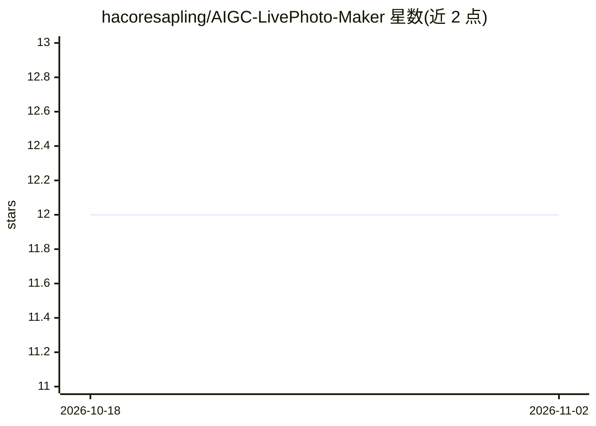

# hacoresapling/AIGC-LivePhoto-Maker

⭐ 12 · Python · 推送 2026-03-22 · [GitHub](https://github.com/hacoresapling/AIGC-LivePhoto-Maker) · 个人维护 · 中文 README

**面向普通用户的跨平台 Live/Motion Photo 生成器，可 AI 图生视频**

基于 Python 与 Gradio 的 Web 应用：上传静态图片或短视频，生成可导入 iOS/Android 系统相册、支持长按播放的 Live Photo（ExifTool 注入 UUID 绑定）与 Motion Photo（MP4 二进制追加 + XMP 偏移量）。输入为静态图或不足 3 秒视频时调用智谱 CogVideoX 图生视频模型生成动态背景；未配置 API Key 时降级为 FFmpeg 本地缩放/平移动效。运行需 Python 3.8+ 且自行安装 FFmpeg 与 ExifTool。

## 筛选速览

| 维度 | 判定 | 备注 |
|---|---|---|
| AI 角色 | `ai-native` | 本体是模型或模型工具 |
| 许可风险 | `permissive` | — |
| 部署形态 | `desktop` | 安装包/桌面程序 |
| 模型依赖 | — | README 未给出锁定关系 |
| 硬件要求 | — | 无带数字的原话,不猜 |
| 安装摩擦 | `medium` | 含编译或系统依赖之一 |
| 成熟度 | — | 结构信号不足 |

## 能力要点

- Apple Live Photo：ExifTool 注入 36 位 UUID 实现图片与视频配对绑定
- Android Motion Photo：MP4 数据追加至 JPG 尾部并注入 XMP 偏移量
- 内置智能路由：静态图自动调用智谱 CogVideoX 图生视频生成动态背景
- 无 API Key 时自动降级为 FFmpeg 本地动效

## 适用场景

- 把静态照片转成手机可长按播放的实况图
- 将短视频封装为 Apple/Android 原生动态照片格式
- 无 AI Key 时用本地 FFmpeg 生成基础动效的动态图

## 场景标签

`视频生成` · 领域:内容生成

## 证据(README 行号)

> L16: 更进一步，项目内置 **智谱 CogVideoX 图生视频大模型**，当素材为纯静态图片时，AI 将自动为其生成平滑自然的 3 秒动态背景——让每一张照片都"活"起来。
> L42: - 输入为**静态图片**或**不足 3 秒的短视频**时 → 自动调用 **智谱 CogVideoX** 图生视频模型，生成 3 秒动态背景
> L144: 本项目接入 **智谱 CogVideoX** 图生视频模型，支持从单张静态图片生成流畅的动态视频片段。

## 星数曲线

2026-10-18 12 → 2026-11-02 12（+0）

---
*卡片 v1 · prompt 1.4 · 生成 2026-11-01 · 置信度 mid · 依据 README sha `2b8b5a1af3f3` · [字段定义](../../DATASET.md)*
