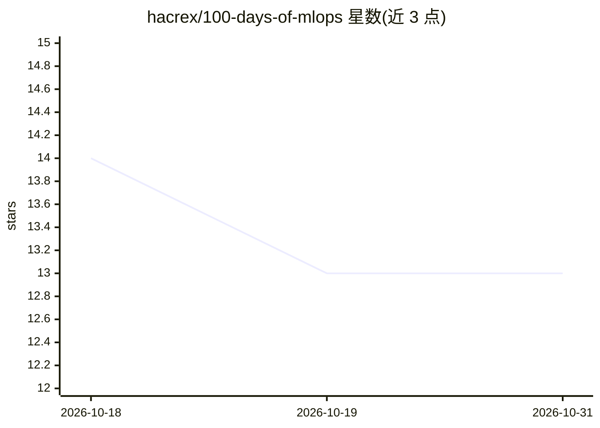

# hacrex/100-days-of-mlops

⭐ 13 · Python · NOASSERTION · 推送 2026-05-20 · [GitHub](https://github.com/hacrex/100-days-of-mlops) · 个人维护

**MLOps 100 天实践学习仓库：每日一项生产 ML 工程技能**

个人学习记录型仓库：按天组织 100 个 MLOps 主题（day-001 至 day-100），从虚拟环境、DVC 数据版本化、MLflow 实验跟踪，到 Docker、Kubernetes、Argo、Kubeflow 部署编排与 Prometheus/Grafana 监控。每个 day 目录含 README、源码/配置、commands.sh、锁定依赖的 requirements.txt 与笔记；另设 4 个端到端 capstone 项目（多数标记进行中）。追踪表显示约 12 天标记完成，其余为待做；灵感来自 KodeKloud 课程。

## 筛选速览

| 维度 | 判定 | 备注 |
|---|---|---|
| AI 角色 | `ai-knowledge` | 知识聚合/清单类 |
| 许可风险 | `none` | NOASSERTION |
| 部署形态 | `self-host` | docker 或自建部署 |
| 模型依赖 | — | README 未给出锁定关系 |
| 硬件要求 | — | 无带数字的原话,不猜 |
| 安装摩擦 | `low` | 无编译、无系统依赖或容器化 |
| 成熟度 | — | 结构信号不足 |

## 能力要点

- 100 个按日组织的 MLOps 主题，覆盖数据版本化到 K8s 部署监控全流程
- 每日目录含 README、源码、commands.sh、锁定依赖与实现笔记
- 4 个端到端 capstone 项目（ML 系统、Argo 流水线、监控再训练、可观测性）

## 适用场景

- 按日程系统学习生产级 MLOps 工程技能
- 查找 DVC/MLflow/Feast/Kubeflow 等工具的最小实践示例
- 参考 ML 系统的监控与可观测性实现思路

## 场景标签

`教程课程` `MLOps` · 领域:学习与行业

## 证据(README 行号)

> L9: A daily practice log where each day covers one concrete MLOps skill. Every day folder contains:
> L20: ├── days/                    # Daily practice folders (day-001 through day-100)

## 星数曲线

2026-10-18 14 → 2026-10-31 13（-1）

---
*卡片 v1 · prompt 1.4 · 生成 2026-10-31 · 置信度 mid · 依据 README sha `f1885ec8f2b8` · [字段定义](../../DATASET.md)*
