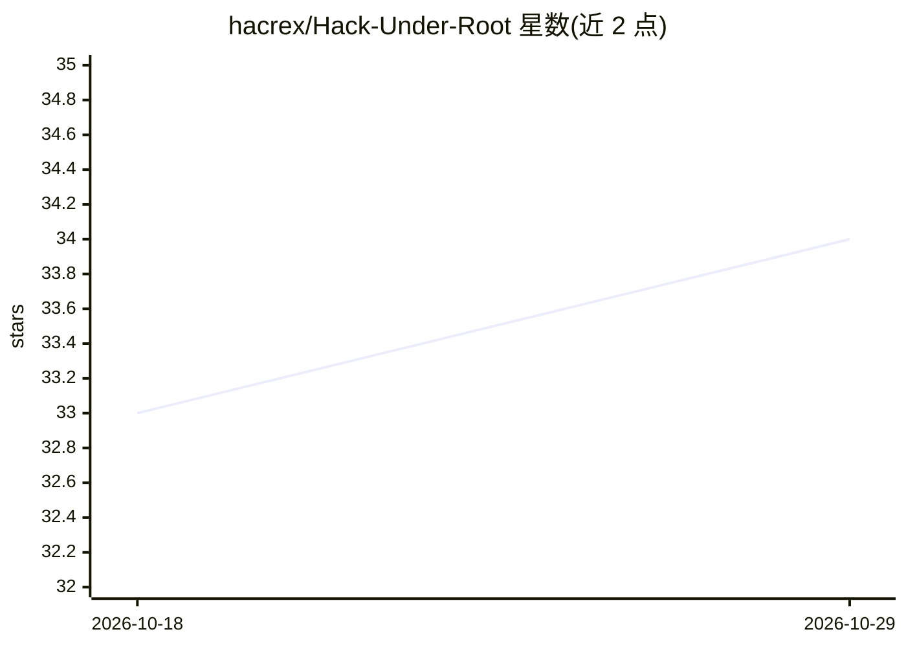

# hacrex/Hack-Under-Root

⭐ 34 · HTML · 推送 2026-06-28 · [GitHub](https://github.com/hacrex/Hack-Under-Root) · [官网](http://hackunderroot.blogspot.in/) · 组织维护

**十年技术演进档案库：支撑网络安全/Linux/AI/DevSecOps 博客**

自 2013 年运行的技术博客 Hack-Under-Root 的研究与文档存档仓库，包含十多年的研究笔记、文章草稿与技术深度分析，覆盖网络安全、Linux 与操作系统、人工智能、云与 DevOps、IoT 与网络等类别。读者定位为白帽黑客、系统管理员、DevOps 工程师与 AI 研究者。内容以 Markdown 版本化存储，配合 Google Sheets/Airtable 作为无头 CMS 管理选题，并有 Python 脚本对接 Blogger API 实现自动发布。

## 筛选速览

| 维度 | 判定 | 备注 |
|---|---|---|
| AI 角色 | `ai-knowledge` | 知识聚合/清单类 |
| 许可风险 | `permissive` | — |
| 部署形态 | `None` |  |
| 模型依赖 | — | README 未给出锁定关系 |
| 硬件要求 | — | 无带数字的原话,不猜 |
| 安装摩擦 | `low` | 无编译、无系统依赖或容器化 |
| 成熟度 | — | 结构信号不足 |

## 能力要点

- 按年份归档的技术研究笔记与文章草稿（2013 至今）
- 覆盖网络安全、Linux、AI、云/DevOps、IoT 五大类别
- Markdown 优先的版本化写作流程，Python 脚本对接 Blogger API 自动发布

## 适用场景

- 查阅网络安全与 DevSecOps 十年技术演进的时间线资料
- 作为技术博客写作与归档流程的参考实现
- 了解 2013–2025 年安全技术热点的历史脉络

## 场景标签

`网络安全` · 领域:学习与行业

## 证据(README 行号)

> L13: **Hack-Under-Root** is a comprehensive technology documentation project and digital archive. It serves as the backb
> L15: This repository contains over a decade of research notes, article drafts, and technical deep-dives, bridging the ga

## 星数曲线

2026-10-18 33 → 2026-10-29 34（+1）

---
*卡片 v1 · prompt 1.4 · 生成 2026-10-25 · 置信度 high · 依据 README sha `e5cc525e85c7` · [字段定义](../../DATASET.md)*
