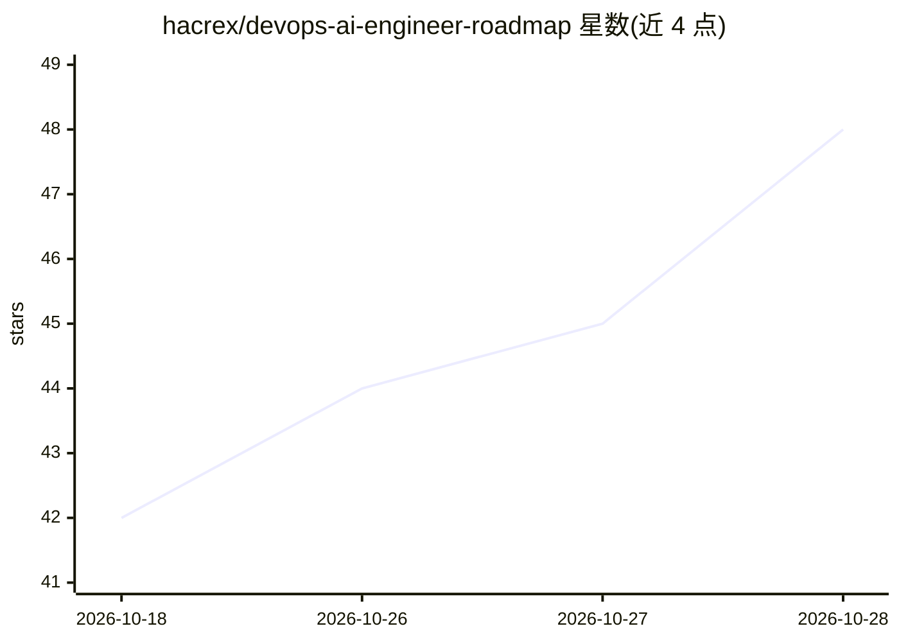

# hacrex/devops-ai-engineer-roadmap

⭐ 48 · Python · NOASSERTION · 推送 2026-06-03 · [GitHub](https://github.com/hacrex/devops-ai-engineer-roadmap) · 个人维护

**面向 DevOps/SRE 的 AI 基础设施工程学习路线图**

项目优先的学习路线图仓库，面向已有 DevOps/SRE/平台/云背景的工程师转型 AI 平台工程：将 Linux、Kubernetes、Terraform、CI/CD、可观测性等传统技能与本地 LLM、GPU 调度、推理服务、RAG、Agent、MCP、AI 安全衔接。包含 24 周路线图、12 天实操系列、12 个模块课程与 5 个可运行的毕业项目（本地 RAG 助手、AI DevOps Copilot、日志分析流水线、K8s AI 平台、AI SRE Agent），部分实验在无 GPU/服务时提供模拟回退。MIT 许可。

## 筛选速览

| 维度 | 判定 | 备注 |
|---|---|---|
| AI 角色 | `ai-knowledge` | 知识聚合/清单类 |
| 许可风险 | `none` | NOASSERTION |
| 部署形态 | `self-host` | docker 或自建部署 |
| 模型依赖 | — | README 未给出锁定关系 |
| 硬件要求 | — | 无带数字的原话,不猜 |
| 安装摩擦 | `low` | 无编译、无系统依赖或容器化 |
| 成熟度 | — | 结构信号不足 |

## 能力要点

- 24 周分阶段路线图 + 12 天实操学习序列
- 12 个模块覆盖本地 LLM、K8s AI、RAG、Agent、MCP、AIOps、AI 安全
- 5 个可运行的毕业项目（RAG 助手 / Copilot / 日志分析 / K8s 平台 / SRE Agent）
- 无 GPU 或服务不可用时项目提供本地模拟回退

## 适用场景

- DevOps/SRE 工程师系统学习 AI 平台工程技能
- 按初级/中级/高级路径选择学习入口
- 通过毕业项目搭建作品集并本地运行实践

## 场景标签

`教程课程` · 领域:学习与行业

## 证据(README 行号)

> L8: A practical, project-first roadmap for DevOps, Platform, SRE, and Cloud engineers who want to become **AI Infrastruc
> L10: This repository connects traditional infrastructure skills—Linux, containers, Kubernetes, Terraform, CI/CD, observa

## 星数曲线

2026-10-18 42 → 2026-10-28 48（+6）

---
*卡片 v1 · prompt 1.4 · 生成 2026-10-25 · 置信度 mid · 依据 README sha `05f7c0338246` · [字段定义](../../DATASET.md)*
