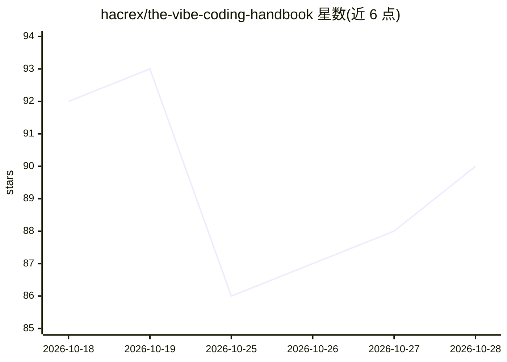

# hacrex/the-vibe-coding-handbook

⭐ 90 · HTML · NOASSERTION · 推送 2026-07-26 · [GitHub](https://github.com/hacrex/the-vibe-coding-handbook) · [官网](https://vibingcode.vercel.app/) · 个人维护

**AI 辅助软件开发（Vibe Coding）从入门到部署的开源知识手册**

社区驱动的知识库，教授如何与 AI 协作完成软件设计、构建、调试、测试、部署与扩展。内容组织为 30 个章节，覆盖提示词工程、前后端、数据库、DevOps、本地 AI 与隐私、AI Agent、RAG、变现与自由职业等，并给出初级/中级/高级三条项目制学习路线。同时提供推荐技术栈、AI IDE 与聊天助手对比、基于 Ollama 的本地 AI 安装示例。多数章节标注为编写中（In Progress）。

## 筛选速览

| 维度 | 判定 | 备注 |
|---|---|---|
| AI 角色 | `ai-knowledge` | 知识聚合/清单类 |
| 许可风险 | `permissive` | NOASSERTION |
| 部署形态 | `None` |  |
| 模型依赖 | — | README 未给出锁定关系 |
| 硬件要求 | — | 无带数字的原话,不猜 |
| 安装摩擦 | `low` | 无编译、无系统依赖或容器化 |
| 成熟度 | `idea` | |

## 能力要点

- 30 个章节覆盖 AI 辅助开发从基础到部署全流程
- 初级/中级/高级三条项目制学习路线图
- Ollama 本地 AI 安装与离线 Vibe Coding 章节
- AI IDE、聊天助手模型对比及推荐技术栈

## 适用场景

- 系统学习如何与 AI 协作开发并部署生产级软件
- 搭建本地 LLM 实现离线 AI 辅助编码
- 查找提示词模板与学习项目点子

## 场景标签

`教程课程` · 领域:学习与行业

## 证据(README 行号)

> L9: A comprehensive, community-driven knowledge base teaching you how to build production-ready software with AI assista
> L110: This repository contains **30 comprehensive sections** covering every aspect of AI-assisted development:

## 星数曲线

2026-10-18 92 → 2026-10-28 90（-2）

---
*卡片 v1 · prompt 1.4 · 生成 2026-10-23 · 置信度 high · 依据 README sha `f72e136e88ef` · [字段定义](../../DATASET.md)*
