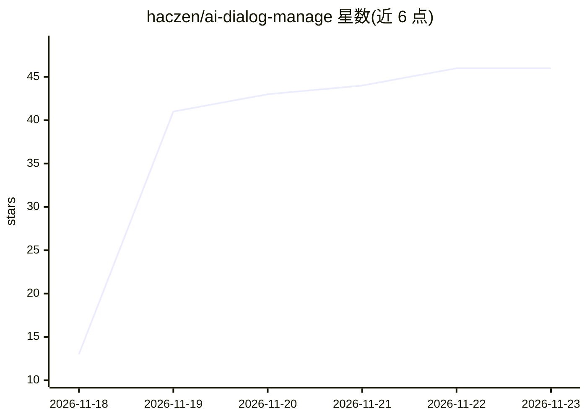

# haczen/ai-dialog-manage

⭐ 46 · Python · MIT · 推送 2026-11-18 · [GitHub](https://github.com/haczen/ai-dialog-manage) · 个人维护 · 中文 README

**统一管理 9 种 AI 编程工具聊天记录的桌面工具**

PyQt6 桌面应用，扫描本机 Claude Code、Codex、OpenCode、Gemini CLI、Qwen Code、Goose、Cline、Roo Code、Kiro 九种来源的会话文件，提供统一浏览、搜索、编辑、批量处理。写入前自动备份、原子写入、外部修改检测。特色机制是「转生」：将会话转换为另一工具的格式并改写工作目录后导入其会话库；另有「意识上传」导出自包含恢复包。支持命令行 transplant、repair、selftest。

## 筛选速览

| 维度 | 判定 | 备注 |
|---|---|---|
| AI 角色 | `ai-ecosystem` | LLM/agent 周边工具 |
| 许可风险 | `permissive` | MIT |
| 部署形态 | `desktop` | 安装包/桌面程序 |
| 模型依赖 | — | README 未给出锁定关系 |
| 硬件要求 | — | 无带数字的原话,不猜 |
| 安装摩擦 | `low` | 无编译、无系统依赖或容器化 |
| 成熟度 | — | 结构信号不足 |

## 能力要点

- 扫描并统一管理 9 种 AI CLI 工具的本地会话存储
- 会话跨工具转生：格式转换 + 新 id + 工作目录改写
- 编辑写入前自动备份，外部改动检测拒绝覆盖
- 意识上传导出自包含文件夹，目标机器无需 Python

## 适用场景

- 在一个窗口里浏览和搜索多个 AI 编程工具的历史对话
- 会话做到一半换工具或换目录，带着上下文继续聊
- 编辑或修复损坏的 Claude 会话链
- 把会话打包迁移到未装工具链的机器上

## 场景标签

 · 领域:开发者工具/AI CLI 会话管理

## 证据(README 行号)

> L7: 统一浏览 / 搜索 / 编辑 **9 种 AI 工具**的会话,还能把任意一段对话
> L95: 1. 选目标工具(Claude / Codex / OpenCode / Gemini / Qwen / Goose / Cline / Roo / JSON)
> L140: |**Claude Code**|`~/.claude/projects/<路径>/<id>.jsonl`|✅|`claude --resume <id>`|

## 星数曲线

2026-11-18 13 → 2026-11-23 46（+33）

---
*卡片 v1 · prompt 1.4 · 生成 2026-11-18 · 置信度 high · 依据 README sha `5e8cedd58846` · [字段定义](../../DATASET.md)*
