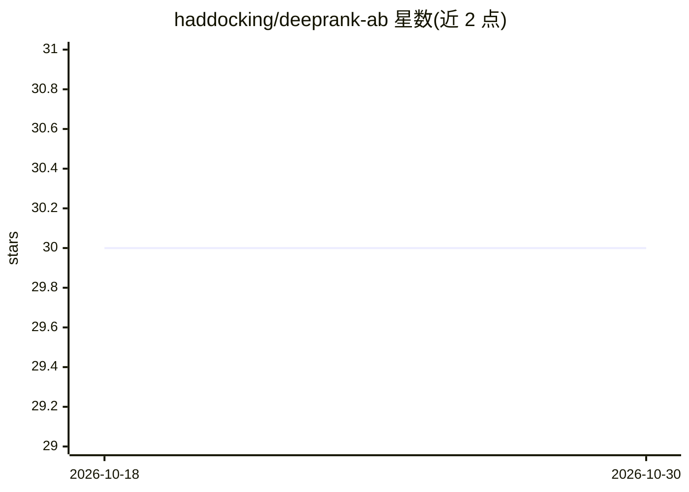

# haddocking/deeprank-ab

⭐ 30 · Python · NOASSERTION · 推送 2026-07-29 · [GitHub](https://github.com/haddocking/deeprank-ab) · 组织维护

**抗体-抗原对接模型打分工具：预测 DockQ 分数**

几何深度学习打分函数，面向抗体-抗原复合物结构研究者：输入 PDB 文件，自动执行链检测（ANARCI）、特征生成（ESM-2 嵌入、CDR 注释、原子级图）与 EGNN 推理，输出预测 DockQ 分数及结构质量标志（重轻链接触、范德华冲突）。仅支持 Linux（内置 hmmscan/voronota 为 x86-64 ELF 二进制），macOS 需用 Docker；首次运行下载约 2.5GB ESM-2 权重。提供 pip 安装与 GHCR 的 CPU/GPU 镜像。

## 筛选速览

| 维度 | 判定 | 备注 |
|---|---|---|
| AI 角色 | `ai-native` | 本体是模型或模型工具 |
| 许可风险 | `none` | NOASSERTION |
| 部署形态 | `self-host` | docker 或自建部署 |
| 模型依赖 | — | README 未给出锁定关系 |
| 硬件要求 | — | 无带数字的原话,不猜 |
| 安装摩擦 | `low` | 无编译、无系统依赖或容器化 |
| 成熟度 | — | 结构信号不足 |

## 能力要点

- 从原始 PDB 自动完成链检测、特征生成到 EGNN 推理的完整流水线
- 输出预测 DockQ 分数及 HL 接触/范德华冲突质量标志
- GHCR 提供 CPU/GPU 两类 Docker 镜像
- 内置 ANARCI 与 germline 数据库副本

## 适用场景

- 对候选抗体-抗原对接模型打分排序
- 预测复合物的 DockQ 分数并检查结构质量
- 批量评估 PDB 对接构象集合

## 场景标签

 · 领域:计算结构生物学/抗体工程

## 证据(README 行号)

> L3: DeepRank-Ab is a geometric deep learning scoring function for ranking antibody-antigen docking
> L5: (ESM-2 embeddings, CDR annotation, atom-level graphs), and EGNN inference to produce a predicted

## 星数曲线

2026-10-18 30 → 2026-10-30 30（+0）

---
*卡片 v1 · prompt 1.4 · 生成 2026-10-26 · 置信度 high · 依据 README sha `87155e7e6396` · [字段定义](../../DATASET.md)*
