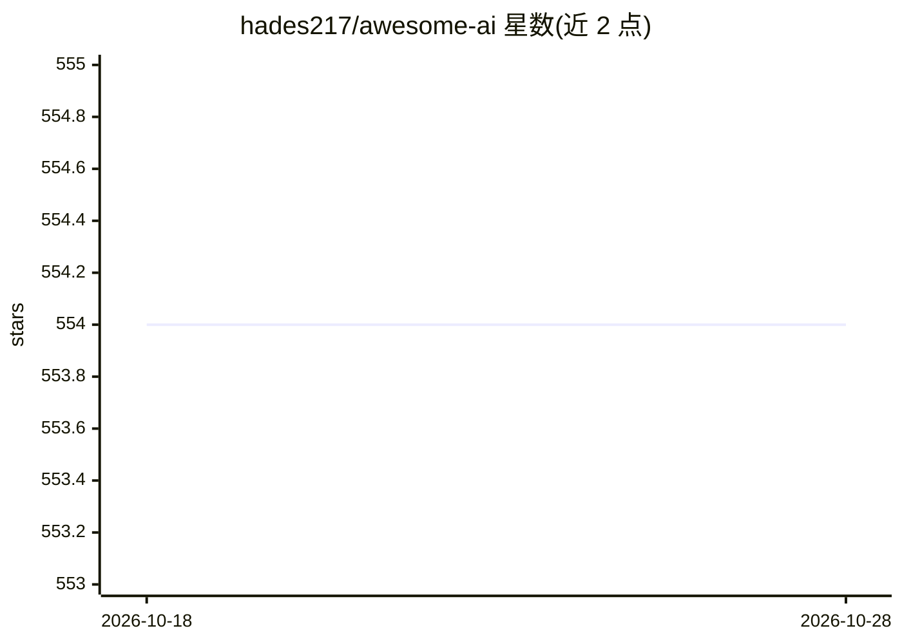

# hades217/awesome-ai

⭐ 554 · MIT · 推送 2026-10-19 · [GitHub](https://github.com/hades217/awesome-ai) · [官网](https://jracademy.ai/) · 个人维护 · 中文 README

**AI 资源策展清单：模型、工具、框架、课程等分类收录**

自 2017 年由 Lightman Wang 维护的社区策展清单，收录 AI 资源条目并按类别组织：基础模型与 API、开放权重模型、多模态生成、AI 编码工具、Agent 框架与 MCP、RAG 与向量数据库、推理与托管、LLM 观测、微调训练、深度学习框架等，另含课程、公司与国家 AI 生态章节。条目带编辑精选/热度/新条目标记与星数，通过 PR 与讨论接受贡献，许可为 CC0-1.0，提供英文与简体中文版本。

## 筛选速览

| 维度 | 判定 | 备注 |
|---|---|---|
| AI 角色 | `ai-knowledge` | 知识聚合/清单类 |
| 许可风险 | `permissive` | MIT |
| 部署形态 | `None` |  |
| 模型依赖 | — | README 未给出锁定关系 |
| 硬件要求 | — | 无带数字的原话,不猜 |
| 安装摩擦 | `low` | 无编译、无系统依赖或容器化 |
| 成熟度 | — | 结构信号不足 |

## 能力要点

- 按 10+ 类别组织 AI 资源条目，含编辑精选与季度更新栏目
- 条目附星数与 🇨🇳/🇦🇺 地区聚焦标记
- 收录模型、工具、框架、向量库、观测、微调等完整链条
- 通过 GitHub PR 接受社区贡献，双语文档

## 适用场景

- 查找各类别 AI 工具与框架的候选清单
- 入门者按编辑精选快速了解主流 AI 资源
- 跟踪 2026 年新兴 AI 工具与 Agent 生态

## 场景标签

`精选清单` · 领域:学习与行业

## 证据(README 行号)

> L10: > A community-curated list of artificial intelligence resources — foundation models, agent frameworks, AI coding to
> L12: Maintained since 2017 by Lightman Wang (LinkedIn).

## 星数曲线

2026-10-18 554 → 2026-10-28 554（+0）

---
*卡片 v1 · prompt 1.4 · 生成 2026-10-21 · 置信度 high · 依据 README sha `28644bcc62ab` · [字段定义](../../DATASET.md)*
