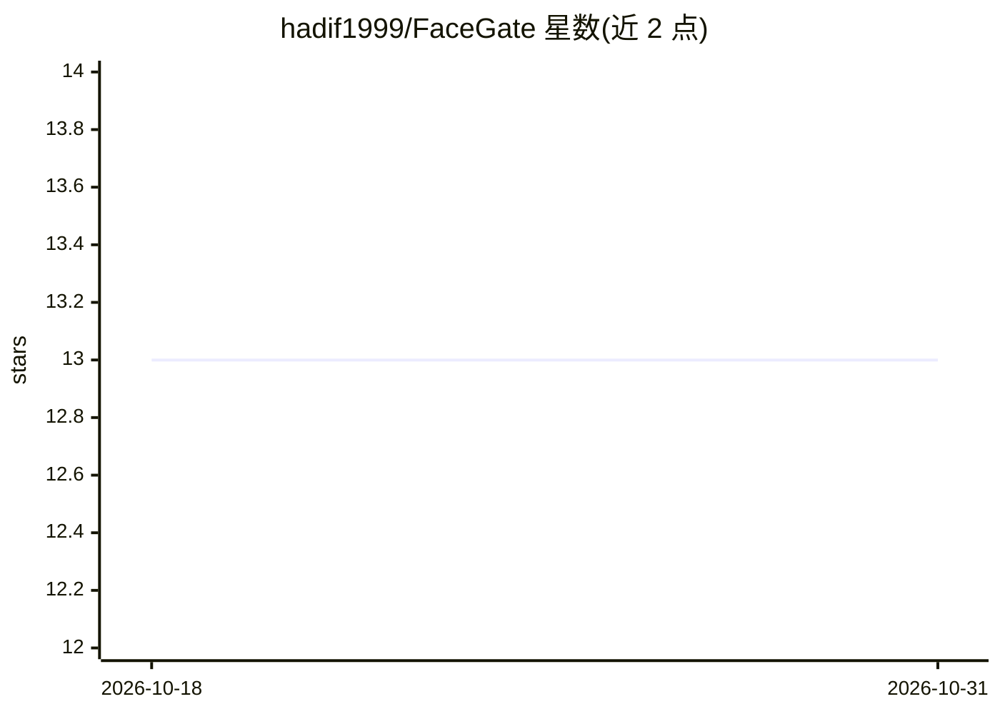

# hadif1999/FaceGate

⭐ 13 · Python · 推送 2026-06-21 · [GitHub](https://github.com/hadif1999/FaceGate) · 个人维护

**本地人脸识别服务：从摄像头流识别会员并经 WebSocket 通信**

面向场馆（默认健身房配置）的本地轻量人脸识别服务：连接 RTSP/HTTP/本地摄像头，使用 OpenCV YuNet 检测与 SFace 识别（本地 ONNX 模型），将人脸嵌入存入本地 SQLite，成员数据不外发。作为 WebSocket 客户端与外部场馆软件通过 JSON 协议交互，支持注册、删除、摄像头状态检查、预览窗口开关、数据库备份恢复等命令；每摄像头一个识别 worker 进程，断线自动重连。提供 Windows/Linux 发布包，也可 uv 从源码运行，附 GUI 与 CLI 测试服务器。

## 筛选速览

| 维度 | 判定 | 备注 |
|---|---|---|
| AI 角色 | `ai-native` | 本体是模型或模型工具 |
| 许可风险 | `none` | — |
| 部署形态 | `desktop` | 安装包/桌面程序 |
| 模型依赖 | — | README 未给出锁定关系 |
| 硬件要求 | — | 无带数字的原话,不猜 |
| 安装摩擦 | `low` | 无编译、无系统依赖或容器化 |
| 成熟度 | — | 结构信号不足 |

## 能力要点

- OpenCV YuNet 检测 + SFace 识别，嵌入存本地 SQLite
- WebSocket 客户端 JSON 协议：10 种入站命令、5 种出站事件
- 每摄像头独立 worker 进程，断线重连与识别冷却
- getDB/restoreDB 文件夹级备份恢复数据库与配置并重启

## 适用场景

- 健身房等场馆通过摄像头识别会员进出
- 与现有场馆管理软件通过 WebSocket 集成做人员识别
- 需要成员数据保留在本地的门禁/识别场景

## 场景标签

`人脸识别` · 领域:感知与多模态

## 证据(README 行号)

> L3: FaceGate is a local lightweight face recognition service for facilities that identifies members from camera streams 
> L31: - detect and recognize faces using OpenCV YuNet and SFace
> L259: - Recognition uses local ONNX models through OpenCV YuNet and SFace.

## 星数曲线

2026-10-18 13 → 2026-10-31 13（+0）

---
*卡片 v1 · prompt 1.4 · 生成 2026-10-31 · 置信度 high · 依据 README sha `dcfbc7a5d9db` · [字段定义](../../DATASET.md)*
