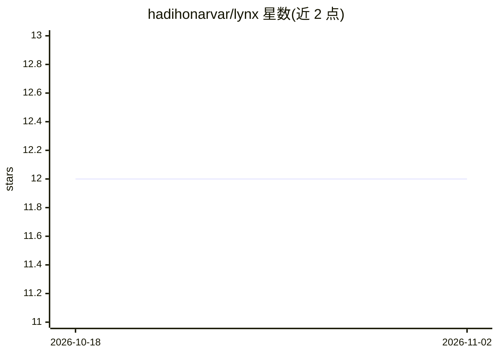

# hadihonarvar/lynx

⭐ 12 · Python · NOASSERTION · 推送 2026-08-01 · [GitHub](https://github.com/hadihonarvar/lynx) · [官网](https://pypi.org/project/lynx-agent/) · 个人维护

**AI agent 工具调用的策略治理内核：五裁决门控与审计**

面向构建 agent 应用的 Python 库，在 agent 循环的工具调用边界执行策略门控：每次调用得到 allow/deny/dry_run/approve_required/transform 五种裁决之一，并输出流式审计事件。内核为无状态纯函数，不含存储与全局状态；提供预算上限（步数/token/时长）、kill-switch、重复调用门与可崩溃恢复的持久运行（需自实现 RunStore）。支持以 ToolGuard 嵌入 OpenAI Agents SDK/LangChain/CrewAI 等框架、MCP 代理模式与多 agent 交接图；不提供提示词过滤与集群编排。

## 筛选速览

| 维度 | 判定 | 备注 |
|---|---|---|
| AI 角色 | `ai-ecosystem` | LLM/agent 周边工具 |
| 许可风险 | `none` | NOASSERTION |
| 部署形态 | `library` | 以包/库形式分发 |
| 模型依赖 | local-ok | 支持本地模型 |
| 硬件要求 | — | 无带数字的原话,不猜 |
| 安装摩擦 | `low` | 无编译、无系统依赖或容器化 |
| 成熟度 | — | 结构信号不足 |

## 能力要点

- 五种裁决的工具调用策略门控（allow/deny/dry_run/approve_required/transform）
- 步数/token/时长预算、kill-switch 与重复调用门
- 持久恢复：崩溃后从首个未完成步继续，不重跑副作用
- ToolGuard 嵌入主流 agent 框架；MCP 代理对任意 MCP server 零改动生效

## 适用场景

- 给 agent 的工具调用加策略审批与审计边界
- 给 irreversible 工具配置 dry_run 影子预览与人工审批
- 在自有框架（LangChain/CrewAI 等）中复用同一套治理内核
- 通过 MCP 代理治理 Claude Desktop/Cursor 等客户端的工具调用

## 场景标签

`Agent 框架` `LLM 可观测性` · 领域:Agent 开发

## 证据(README 行号)

> L15: **Lynx is the governance and safety layer for your agent's loop — not the loop itself.** Every iteration of an agen
> L45: - **Framework-native governance** *(optional)*. When an agent *framework* owns the loop (OpenAI Agents SDK, LangCha

## 星数曲线

2026-10-18 12 → 2026-11-02 12（+0）

---
*卡片 v1 · prompt 1.4 · 生成 2026-11-01 · 置信度 high · 依据 README sha `67fdd09b732c` · [字段定义](../../DATASET.md)*
