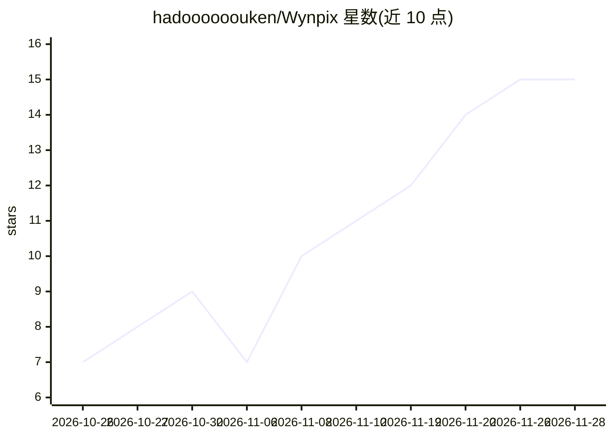

# hadoooooouken/Wynpix

⭐ 15 · C++ · GPL-3.0 · 推送 2026-11-26 · [GitHub](https://github.com/hadoooooouken/Wynpix) · [官网](https://github.com/hadoooooouken/wynpix/releases/latest) · 个人维护 · 中文 README

**Windows 用户的快速 GPU 加速图片查看器，含实时 AI 放大**

面向 Windows 的 C++/Qt 图片查看器，主打速度与现代格式：所有查看器缩放滤镜运行于 GPU（Qt Quick，Direct3D 11/12/Vulkan），原生支持 AVIF、JXL、HEIC、PSD、相机 RAW、EXR 等格式。集成 upscayl-ncnn（NCNN/Vulkan 与 RealESRGAN）实现实时 AI 放大，仅放大可见视口以节省 VRAM，支持在 models/ 目录添加自定义模型；另提供 HDR 色调映射、360° 全景视图、批量转换器、Explorer 缩略图扩展、ComfyUI 工作流参数解析与 9 种语言界面。通过发布版二进制下载安装，另提供面向旧机型的 SSE2 构建。

## 筛选速览

| 维度 | 判定 | 备注 |
|---|---|---|
| AI 角色 | `ai-enhanced` | 去掉 AI 部分产品仍成立 |
| 许可风险 | `viral` | GPL-3.0 |
| 部署形态 | `desktop` | 安装包/桌面程序 |
| 模型依赖 | — | README 未给出锁定关系 |
| 硬件要求 | — | 无带数字的原话,不猜 |
| 安装摩擦 | `low` | 无编译、无系统依赖或容器化 |
| 成熟度 | — | 结构信号不足 |

## 能力要点

- 实时 AI 放大（upscayl-ncnn，NCNN/Vulkan & RealESRGAN），支持自定义模型
- 原生支持 AVIF、JXL、HEIC、PSD、RAW、EXR 等现代格式
- Windows Explorer 64 位缩略图 shell 扩展
- 批量转换器、HDR 色调映射与 360° 全景视图

## 适用场景

- 在 Windows 上查看 AVIF/HEIC/RAW 等系统不支持的图片格式
- 实时 AI 放大图片细节
- 查看 ComfyUI 生成图片的模型、采样器、提示词等参数
- 批量转换、缩放或 AI 放大多张图片

## 场景标签

`图像视频处理` · 领域:感知与多模态

## 证据(README 行号)

> L13:  A fast, Windows-optimized image viewer built for speed, visual fidelity, and modern formats.
> L27: * **Real-Time AI Upscaling (Upscayl)**: Real-time AI image upscaling powered by **upscayl-ncnn (NCNN/Vulkan & RealE
> L39: * **Windows Explorer Thumbnail Extension**: 64-bit shell extension (`wynpixshellex.dll`, `IThumbnailProvider`) prov

## 星数曲线

2026-10-26 7 → 2026-11-28 15（+8）

---
*卡片 v1 · prompt 1.4 · 生成 2026-11-18 · 置信度 high · 依据 README sha `556e0e7ab722` · [字段定义](../../DATASET.md)*
