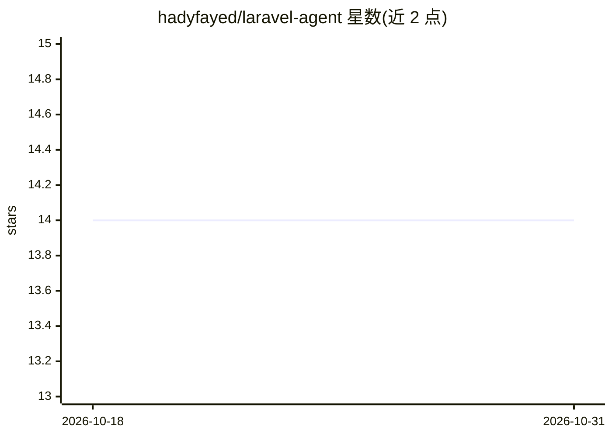

# hadyfayed/laravel-agent

⭐ 14 · Shell · 推送 2026-06-24 · [GitHub](https://github.com/hadyfayed/laravel-agent) · [官网](https://hadyfayed.github.io/laravel-agent/) · 个人维护

**Claude Code 的 Laravel 开发助手插件：66 技能、11 agents**

面向 Claude Code 的 Laravel 开发插件：通过一条 marketplace 命令安装，提供 66 个以 /laravel-agent:<skill> 形式调用的技能（v3.0 由命令迁移为技能），覆盖功能脚手架、REST API、认证、队列、WebSocket、部署、计费、安全审计、性能优化等场景，并含 11 个分工 agent 与按上下文自动激活的技能触发机制。内置 Laravel 代码 lint 与自动格式化 hooks、SOLID/DRY 约束、每项目最多 5 种设计模式的限制，可检测并适配 85+ 已安装包；另有实验性的 Artisan MCP 扩展与交互式引导模式。

## 筛选速览

| 维度 | 判定 | 备注 |
|---|---|---|
| AI 角色 | `ai-ecosystem` | LLM/agent 周边工具 |
| 许可风险 | `none` | — |
| 部署形态 | `None` |  |
| 模型依赖 | — | README 未给出锁定关系 |
| 硬件要求 | — | 无带数字的原话,不猜 |
| 安装摩擦 | `low` | 无编译、无系统依赖或容器化 |
| 成熟度 | — | 结构信号不足 |

## 能力要点

- 66 个技能 + 11 个分工 agent，一条命令经 marketplace 安装
- 技能按上下文关键词自动激活，无需显式调用命令
- 预配置 lint/自动格式化 hooks 与 SOLID/DRY、设计模式数量约束
- 检测并适配 85+ 已安装 Laravel 包，含实验性 Artisan MCP 扩展

## 适用场景

- 用自然语言描述需求，让 architect agent 生成完整 Laravel 功能与测试
- 对现有 Laravel 代码做安全审计、重构与性能优化
- 搭建认证、API、队列、WebSocket、部署等常见基础设施

## 场景标签

`编码 Agent` · 领域:编码与开发

## 证据(README 行号)

> L7: > AI-powered Laravel development assistant - architecture decisions, code generation, testing, deployment, and more.
> L13: > **v3.0.0 — skill-based.** The old colon commands (`/feature:make`) are now **skills** invoked as `/laravel-agent:

## 星数曲线

2026-10-18 14 → 2026-10-31 14（+0）

---
*卡片 v1 · prompt 1.4 · 生成 2026-10-31 · 置信度 high · 依据 README sha `d4d7ebce0863` · [字段定义](../../DATASET.md)*
