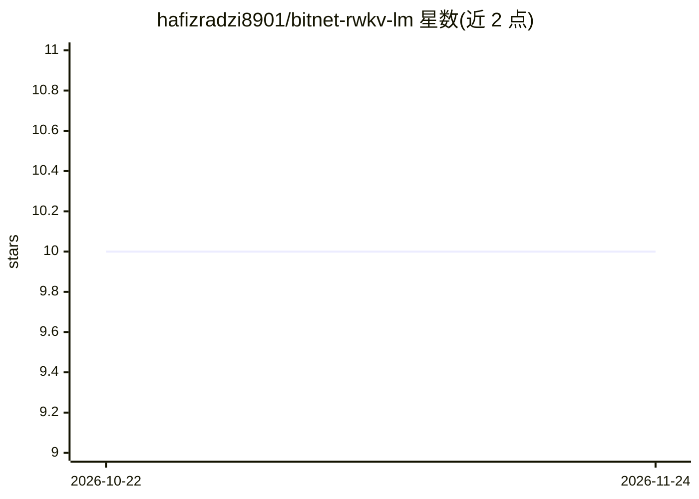

# hafizradzi8901/bitnet-rwkv-lm

⭐ 10 · Python · MIT · 推送 2026-05-30 · [GitHub](https://github.com/hafizradzi8901/bitnet-rwkv-lm) · 个人维护

**8GB GPU 从零训练的 0.15B BitNet RWKV-7 训练推理工具包**

作者在单张 8GB 消费级 GPU（RTX 5060）上从零训练的 0.15B 参数 RWKV-7 模型及其配套训练、推理与微调工具包，含工程日志。关键机制：BitLinear 层实现 1.58-bit 三值权重 QAT（直通估计器）、每字节 4 个权重的 2-bit 打包推理、支持超 4B token 语料的 Parquet→binidx 数据管线、拒绝采样微调（RFT）流程，并附 Gradio 本地聊天界面与 CLI 推理。语料与 checkpoint 未提交，需自备 Parquet 数据；上游 RWKV-LM 与 Microsoft BitNet 需另行 clone。

## 筛选速览

| 维度 | 判定 | 备注 |
|---|---|---|
| AI 角色 | `ai-native` | 本体是模型或模型工具 |
| 许可风险 | `permissive` | MIT |
| 部署形态 | `None` |  |
| 模型依赖 | — | README 未给出锁定关系 |
| 硬件要求 | — | 无带数字的原话,不猜 |
| 安装摩擦 | `medium` | 含编译或系统依赖之一 |
| 成熟度 | — | 结构信号不足 |

## 能力要点

- BitNet b1.58 三值权重量化感知训练（STE，BitLinear 层）
- 2-bit 权重打包推理，降低 VRAM 占用
- 支持超 4B token 语料的并行 Parquet→binidx 数据管线
- 拒绝采样微调（RFT）流程与 Gradio 本地聊天应用

## 适用场景

- 在 8GB 消费级 GPU 上复现从零训练小型 LLM 的完整流程
- 研究 BitNet 1.58-bit QAT 与 2-bit 打包推理的实现细节
- 用自备 Parquet 语料训练并本地聊天推理 RWKV-7 模型

## 场景标签

`微调` `模型量化` `模型训练` · 领域:训练与推理

## 证据(README 行号)

> L3: A **0.15B-parameter RWKV-7 language model with BitNet 1.58-bit (ternary) weights**, trained from
> L8: This repo is the **training, inference, and fine-tuning toolkit** I built around it, plus a detailed

## 星数曲线

2026-10-22 10 → 2026-11-24 10（+0）

---
*卡片 v1 · prompt 1.4 · 生成 2026-11-19 · 置信度 high · 依据 README sha `df4c644b0c3e` · [字段定义](../../DATASET.md)*
