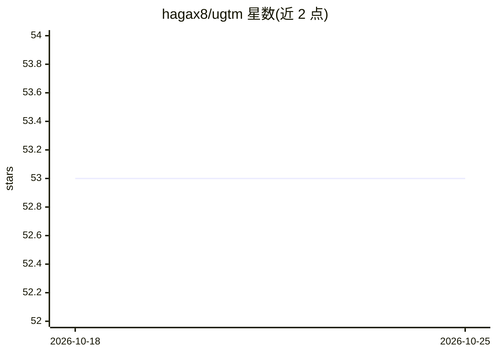

# hagax8/ugtm

⭐ 53 · HTML · MIT · 推送 2026-05-22 · [GitHub](https://github.com/hagax8/ugtm) · [官网](https://ugtm.readthedocs.io/en/latest/overview.html) · 个人维护

**Python 库：实现 GTM 降维及其分类/回归算法**

实现 Generative Topographic Mapping（GTM）及其衍生算法的 Python 包：包含核变体 kGTM、分类图 GTC、回归图 GTR，提供 sklearn 兼容估计器（eGTM/eGTC/eGTR）与重复交叉验证。GTM 是 Bishop 等提出的降维算法，为 Kohonen 映射的概率化对应。绘图模块已移除，输出为 NumPy 数组，需自行用 matplotlib 可视化。要求 Python>=3.8 及 numpy/scikit-learn/scipy/jinja2。

## 筛选速览

| 维度 | 判定 | 备注 |
|---|---|---|
| AI 角色 | `ai-native` | 本体是模型或模型工具 |
| 许可风险 | `permissive` | MIT |
| 部署形态 | `library` | 以包/库形式分发 |
| 模型依赖 | — | README 未给出锁定关系 |
| 硬件要求 | — | 无带数字的原话,不猜 |
| 安装摩擦 | `low` | 无编译、无系统依赖或容器化 |
| 成熟度 | — | 结构信号不足 |

## 能力要点

- 实现 GTM 及核变体 kGTM、分类 GTC、回归 GTR
- 提供 sklearn 兼容估计器 eGTM/eGTC/eGTR
- 支持重复交叉验证
- 输出为 NumPy 数组，可配合 matplotlib 可视化

## 适用场景

- 对高维数据做非线性降维与可视化
- 基于 GTM 图做分类或回归预测
- 在 sklearn 工作流中引入 GTM 估计器

## 场景标签

 · 领域:机器学习/数据建模

## 证据(README 行号)

> L3: GTM (Generative Topographic Mapping) is a dimensionality reduction algorithm (like t-SNE, LLE, etc.) created by Bish
> L5: ugtm implements GTM and GTM-based prediction algorithms, including a kernel variant (kGTM), classification (GTC) and

## 星数曲线

2026-10-18 53 → 2026-10-25 53（+0）

---
*卡片 v1 · prompt 1.4 · 生成 2026-10-24 · 置信度 high · 依据 README sha `f8c71070f1fb` · [字段定义](../../DATASET.md)*
