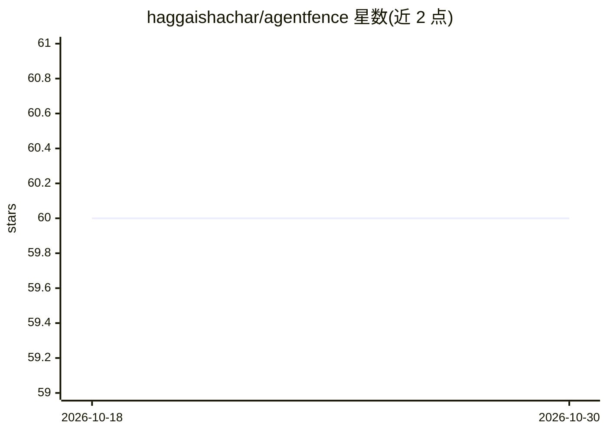

# haggaishachar/agentfence

⭐ 60 · Python · MIT · 推送 2026-08-06 · [GitHub](https://github.com/haggaishachar/agentfence) · [官网](https://agentfence.ai) · 个人维护

**面向开发者的 AI agent 安全自动化测试框架**

开源 AI 安全测试框架，针对 AI agent 自动运行预定义安全探针，检测提示注入、角色混淆、系统指令泄露、密钥泄漏等漏洞，并评估模型抗操纵能力。以 pip 安装的 Python 库形式提供，内置示例代码展示对 OpenAI agent 运行探针并输出通过/失败结果。初始支持 LangChain 与 OpenAI SDK，架构可扩展自定义探针与评估方法。面向 AI 开发者、ML 工程师、安全研究人员及合规风险团队。

## 筛选速览

| 维度 | 判定 | 备注 |
|---|---|---|
| AI 角色 | `ai-ecosystem` | LLM/agent 周边工具 |
| 许可风险 | `permissive` | MIT |
| 部署形态 | `library` | 以包/库形式分发 |
| 模型依赖 | — | README 未给出锁定关系 |
| 硬件要求 | — | 无带数字的原话,不猜 |
| 安装摩擦 | `low` | 无编译、无系统依赖或容器化 |
| 成熟度 | — | 结构信号不足 |

## 能力要点

- 预定义安全探针的自动化探测
- 覆盖提示注入、角色混淆、系统指令泄露等攻击场景
- 初始支持 LangChain 与 OpenAI SDK
- 可扩展添加新探针与评估方法

## 适用场景

- AI 助手/agent 上线前自动做对抗性安全测试
- 红队评估与安全研究中的自动化漏洞探测
- 合规团队在部署前核验 AI 系统安全基线

## 场景标签

`网络安全` · 领域:学习与行业

## 证据(README 行号)

> L7: AgentFence is an **open-source AI security testing framework** that detects vulnerabilities in AI agents. It helps d
> L12: - **Automated AI Security Probing** – Test your AI models against predefined security probes.

## 星数曲线

2026-10-18 60 → 2026-10-30 60（+0）

---
*卡片 v1 · prompt 1.4 · 生成 2026-10-24 · 置信度 high · 依据 README sha `3ee6b87e9001` · [字段定义](../../DATASET.md)*
