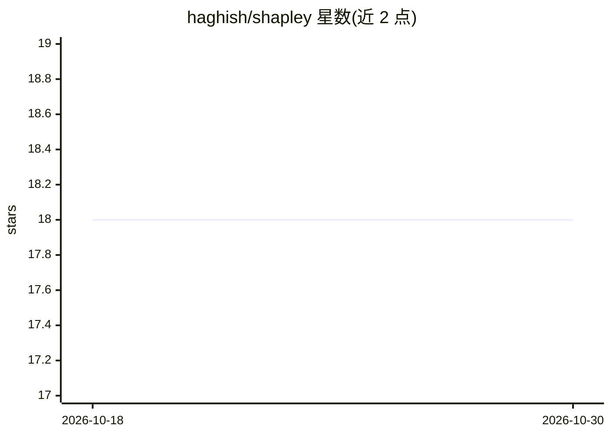

# haghish/shapley

⭐ 18 · R · NOASSERTION · 推送 2026-04-26 · [GitHub](https://github.com/haghish/shapley) · 个人维护

**R 包：为多模型与堆叠集成计算加权平均 SHAP 值与置信区间**

面向探索性机器学习研究的 R 语言包：针对网格搜索得到的多组模型或堆叠集成模型，以模型性能为权重计算加权平均 SHAP 贡献及其 95% 置信区间，解决单一"最佳模型"SHAP 值不稳定（尤其在严重类不平衡下）的问题。支持主体级、特征级与域级三个层级的 SHAP 分析与可视化，提供基于置换检验（默认 5000 次）的特征间显著性差异检验，以及不预设 Top-N 的自动化重要特征识别。示例基于 h2o 模型演示，通过 CRAN 分发。

## 筛选速览

| 维度 | 判定 | 备注 |
|---|---|---|
| AI 角色 | `ai-ecosystem` | LLM/agent 周边工具 |
| 许可风险 | `none` | NOASSERTION |
| 部署形态 | `None` |  |
| 模型依赖 | — | README 未给出锁定关系 |
| 硬件要求 | — | 无带数字的原话,不猜 |
| 安装摩擦 | `low` | 无编译、无系统依赖或容器化 |
| 成熟度 | — | 结构信号不足 |

## 能力要点

- 按模型性能加权计算多模型 SHAP 均值与 95% 置信区间
- 主体级（n）/特征级（p）/域级三层的 SHAP 分析与绘图
- 置换检验评估特征间 SHAP 差异显著性（shapley.test）
- 自动化重要特征识别，无需预设 Top-N 数量

## 适用场景

- 类不平衡场景下评估调参网格中 SHAP 值的稳定性
- 对堆叠集成模型做特征重要性分析并做显著性检验
- 按特征分组（因子/域）汇总 SHAP 贡献

## 场景标签

 · 领域:机器学习可解释性/统计分析

## 证据(README 行号)

> L8: The `shapley` R package addresses a significant limitation in _exploratory_ machine learning research by providing a
> L26: > The shapley algorithm computes weighted mean SHAP values and their 95% confidence intervals for a set of homogene

## 星数曲线

2026-10-18 18 → 2026-10-30 18（+0）

---
*卡片 v1 · prompt 1.4 · 生成 2026-10-29 · 置信度 mid · 依据 README sha `efd7784c6725` · [字段定义](../../DATASET.md)*
