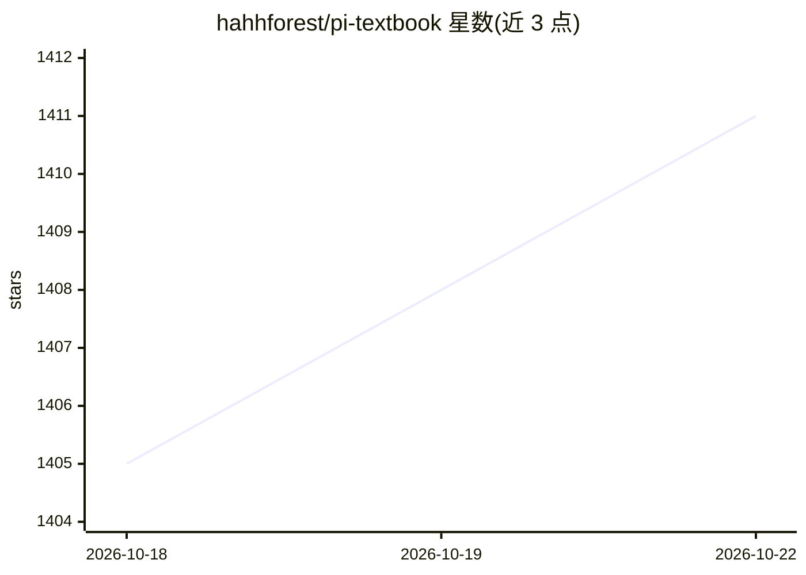

# hahhforest/pi-textbook

⭐ 1,411 · TypeScript · MIT · 推送 2026-07-23 · [GitHub](https://github.com/hahhforest/pi-textbook) · [官网](https://build-your-own-pi-cn.enochzhang.chatgpt.site) · 个人维护 · 中文 README

**中文教材：沿 15 个 checkpoint 从零实现 Pi-style coding agent**

面向开发者的社区原创课程《动手学 Pi》：以 TypeScript 实现 Pi 风格 coding agent，沿 15 个可运行 checkpoint 逐层覆盖协议、流式模型、Provider、工具、Agent Loop、会话树、Context Compaction、扩展与评测。每章由教材正文、真实 commit、聚焦测试与故障实验组成；课程代码是可 checkout 的 Git 历史。非官方课程，不隶属 Pi / Earendil Works；代码 MIT、正文 CC BY 4.0，并支持 checkout 到固定上游 commit 与 tags。

## 筛选速览

| 维度 | 判定 | 备注 |
|---|---|---|
| AI 角色 | `ai-knowledge` | 知识聚合/清单类 |
| 许可风险 | `permissive` | MIT |
| 部署形态 | `library` | 以包/库形式分发 |
| 模型依赖 | — | README 未给出锁定关系 |
| 硬件要求 | — | 无带数字的原话,不猜 |
| 安装摩擦 | `low` | 无编译、无系统依赖或容器化 |
| 成熟度 | — | 结构信号不足 |

## 能力要点

- 15 个 checkpoint 覆盖协议→Provider→工具→Agent Loop→会话树→评测全链路
- 课程代码为可 checkout、运行、验证的真实 Git 历史
- practice 命令可生成不含答案的练习目录，配合陪学 Agent 使用
- 第 14 章为 Runtime 建独立评测（fixture、路径与文件结果核对）

## 适用场景

- 系统学习 coding agent 的实现机制
- 按 checkpoint 动手复现并测试 agent 各组件
- 借助陪学 Agent 辅助练习每章内容

## 场景标签

`教程课程` · 领域:学习与行业

## 证据(README 行号)

> L7:  沿 15 个 checkpoint，从一条离线轨迹开始，亲手实现一个 Pi-style coding agent。
> L18: 沿 15 个可运行 checkpoint，从一条离线 Agent 轨迹出发，逐步实现：
> L22: 每章由四部分闭环：**教材正文 + 真实 commit + 聚焦测试 + 故障实验**。课程代码不是伪代码演示，而是一条可以 checkout、运行和验证的 Git 历史。

## 星数曲线

2026-10-18 1,405 → 2026-10-22 1,411（+6）

---
*卡片 v1 · prompt 1.4 · 生成 2026-10-21 · 置信度 high · 依据 README sha `536d41cf5488` · [字段定义](../../DATASET.md)*
