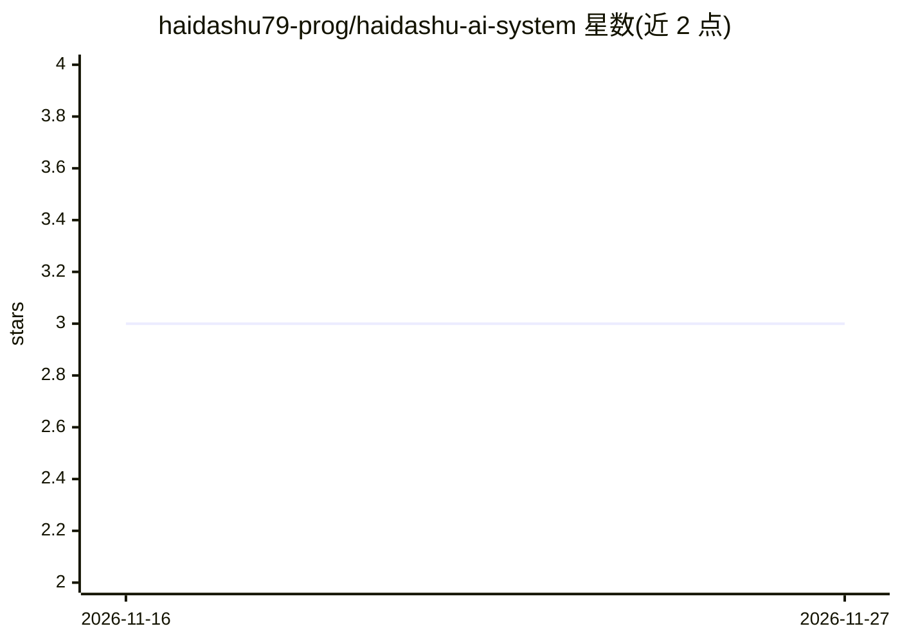

# haidashu79-prog/haidashu-ai-system

⭐ 3 · HTML · NOASSERTION · 推送 2026-11-12 · [GitHub](https://github.com/haidashu79-prog/haidashu-ai-system) · [官网](https://haidashu79-prog.github.io/haidashu-ai-system/) · 个人维护 · 中文 README

**一人公司+AI内容生产线的技能文件与流水线方法论库**

面向个人内容创业者的方法论仓库：将「选题→写稿→出片→交付→复盘」链路固化为四层架构、六个技能目录与八步出片流水线，含任务卡调度、知识库治理与筛选汰换标准；三个环节需本人确认，其余自动。仓库另附作者官网的全站源码与 13 个案例，其中 11 个接入站内 AI 问答（Cloudflare Workers AI 绑定，无需 API Key），可用 wrangler 部署。引擎层实现为私有，不在本仓库内。

## 筛选速览

| 维度 | 判定 | 备注 |
|---|---|---|
| AI 角色 | `ai-knowledge` | 知识聚合/清单类 |
| 许可风险 | `none` | NOASSERTION |
| 部署形态 | `library` | 以包/库形式分发 |
| 模型依赖 | — | README 未给出锁定关系 |
| 硬件要求 | — | 无带数字的原话,不猜 |
| 安装摩擦 | `low` | 无编译、无系统依赖或容器化 |
| 成熟度 | — | 结构信号不足 |

## 能力要点

- 六套技能目录：OPC 专家团、自媒体工作流、出片流水线、任务调度、多租户交付、知识库治理
- 八步出片流水线，三处人工确认点，其余步骤自动执行
- 附官网源码与 13 个案例，11 个接入 Cloudflare Workers AI 站内问答（免 API Key）
- 知识库二分治理：原料仓与可追溯归档层，筛选标准写入文件

## 适用场景

- 一人运营自媒体账号，固化选题到发布的日常流程
- 把内容生产线规格装进他人业务做多租户交付
- 搭建站内 AI 问答案例站并部署到 Cloudflare Pages

## 场景标签

`提示工程` `工作流自动化` `知识库管理` · 领域:Agent 开发

## 证据(README 行号)

> L12: > 本仓库把「AI 超级个体（OPC 一人公司）」的完整打法公开出来：不是概念，是可落地的技能文件、硬规格与执行流水线。
> L45: |OPC 一人公司专家团|`skills/opc-expert-team/`|五类专家：赛道、工具、落地、文案、避坑|docs/03-OPC专家团.md|
> L28: 核心方法论只有一句：**把重复发生的事，写成唯一真源的规格文件；人只做判断，AI 做执行。**

## 星数曲线

2026-11-16 3 → 2026-11-27 3（+0）

---
*卡片 v1 · prompt 1.4 · 生成 2026-11-22 · 置信度 high · 依据 README sha `a00c6f769249` · [字段定义](../../DATASET.md)*
