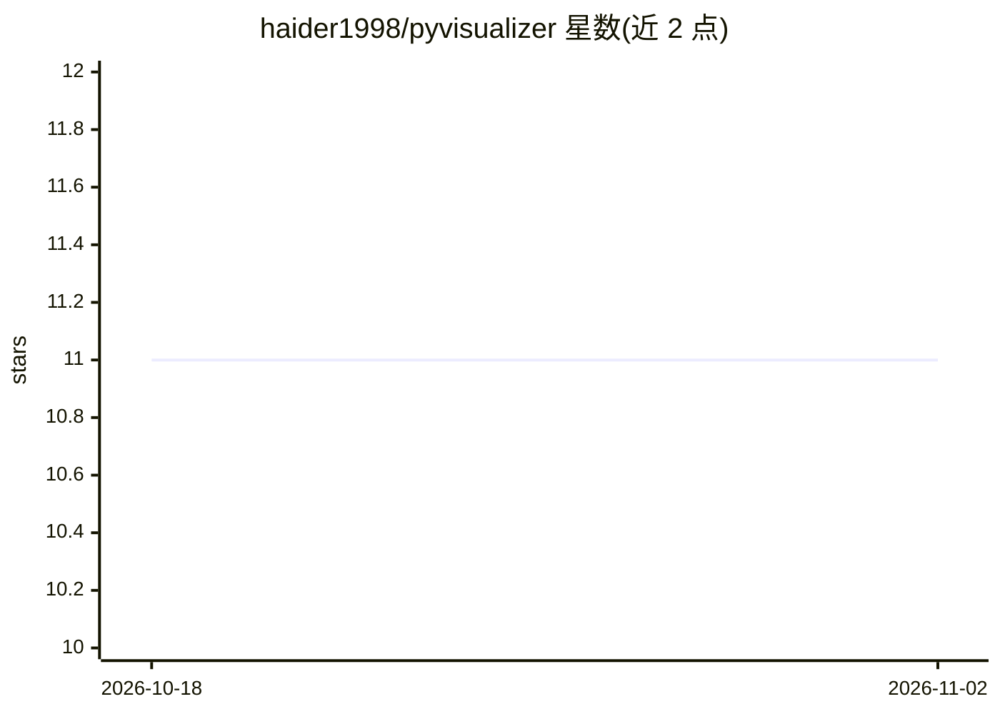

# haider1998/pyvisualizer

⭐ 11 · Python · MIT · 推送 2026-07-26 · [GitHub](https://github.com/haider1998/pyvisualizer) · [官网](https://haider1998.github.io/pyvisualizer/) · 个人维护

**Python 项目调用图的静态分析与可视化工具（AST 确定性）**

通过 AST 静态解析（不导入/不执行代码）生成 Python 项目的确定性调用图，每条边可追溯到 file:line。面向 Python 开发者，覆盖任意框架（Django/FastAPI/ML 流水线）。核心机制：纯本地解析、输出字节级一致、歧义调用标注候选不臆断；可输出 HTML 交互图/Mermaid/JSON 等格式。另一用途是为 AI agent 生成经验证的上下文包（README 称约省 97% token），并提供 MCP server 供 Claude Code/Cursor 实时查询调用图。支持 CI 门禁（分层规则、循环依赖检测）。pip 安装，Python 3.8+（MCP 需 3.10+）。

## 筛选速览

| 维度 | 判定 | 备注 |
|---|---|---|
| AI 角色 | `ai-ecosystem` | LLM/agent 周边工具 |
| 许可风险 | `permissive` | MIT |
| 部署形态 | `library` | 以包/库形式分发 |
| 模型依赖 | — | README 未给出锁定关系 |
| 硬件要求 | — | 无带数字的原话,不猜 |
| 安装摩擦 | `low` | 无编译、无系统依赖或容器化 |
| 成熟度 | — | 结构信号不足 |

## 能力要点

- AST 静态分析生成调用图，每条边可溯源到 file:line，不执行代码
- 输出确定性（字节级一致），支持 CI 门禁：分层规则、循环依赖、架构 diff
- 为 AI agent 生成任务限定的经验证上下文包（--task/--focus，token 预算控制）
- 提供 MCP server（search_code/context_pack/impact 三工具），供 Claude Code/Cursor 实时查询

## 适用场景

- 给未文档化的遗留代码库生成可交互架构图用于 onboarding
- 在 CI 中阻断循环依赖与违反分层规则的 PR
- 重构前评估某函数的影响面（blast radius）
- 为 Claude/Cursor 等 AI 编程工具提供经验证的代码上下文而非整个仓库

## 场景标签

 · 领域:开发者工具/代码静态分析

## 证据(README 行号)

> L19: py-code-visualizer reads your Python source with static analysis (no code is ever
> L143: |`context <path> --focus <fn>`|**Verified context pack for AI agents**: task-scoped, budget-bounded, zero guessed 
> L162: If you use Claude Code or Cursor, the MCP server lets the agent query the verified

## 星数曲线

2026-10-18 11 → 2026-11-02 11（+0）

---
*卡片 v1 · prompt 1.4 · 生成 2026-11-02 · 置信度 high · 依据 README sha `02407b5274fe` · [字段定义](../../DATASET.md)*
