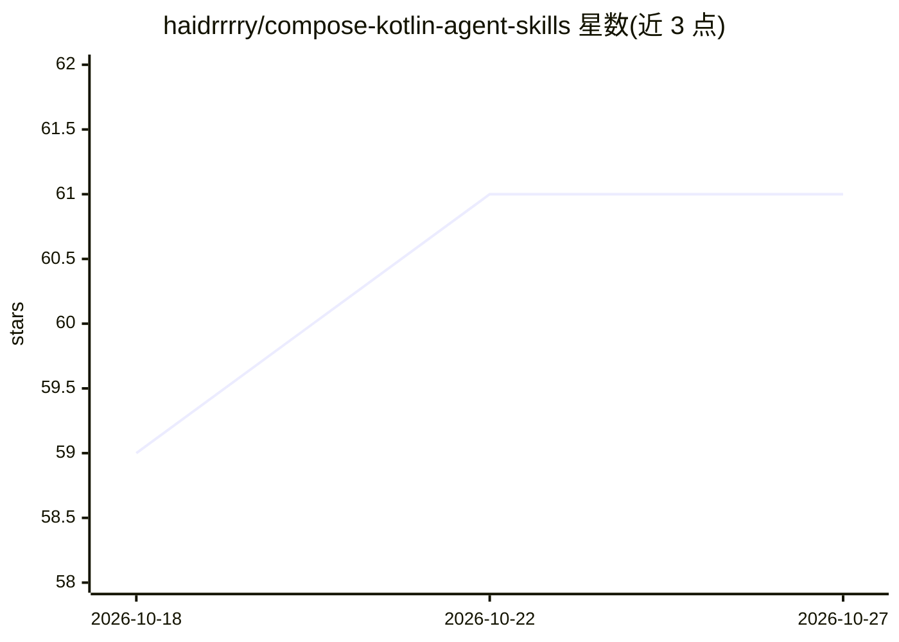

# haidrrrry/compose-kotlin-agent-skills

⭐ 61 · Markdown · MIT · 推送 2026-07-08 · [GitHub](https://github.com/haidrrrry/compose-kotlin-agent-skills) · [官网](https://github.com/haidrrrry/compose-kotlin-agent-skills#readme) · 个人维护

**给 AI 编程代理的 Jetpack Compose/Kotlin 技能知识库**

纯 markdown 形式的 agent 技能包：以根 SKILL.md 为路由入口，配合 3 个模块化子技能（架构/Compose/测试）与 20 个参考模块（00-19），向 Cursor、Claude Code、Codex、Gemini CLI、Copilot 等 27 种 AI 编程代理提供 Kotlin 2.x/Compose 2026 工具链规范、严格 MVI 护栏与禁用反模式查表，并带 REVIEW MODE 的 Compose 屏幕 6 点审计清单。安装方式为 git clone 到各代理的 skills 目录；附 Python 校验脚本与 CI 检查。声明非 Android 库、非语音技能、非模型运行时。

## 筛选速览

| 维度 | 判定 | 备注 |
|---|---|---|
| AI 角色 | `ai-knowledge` | 知识聚合/清单类 |
| 许可风险 | `permissive` | MIT |
| 部署形态 | `None` |  |
| 模型依赖 | — | README 未给出锁定关系 |
| 硬件要求 | — | 无带数字的原话,不猜 |
| 安装摩擦 | `low` | 无编译、无系统依赖或容器化 |
| 成熟度 | — | 结构信号不足 |

## 能力要点

- 根 SKILL.md + 3 个子技能 + 20 个参考模块（00-19）的三层结构
- 禁用反模式 WRONG/RIGHT 查表与严格 MVI 护栏
- REVIEW MODE 6 点 Compose 屏幕审计清单
- 27 个代理专属安装指南与 CI frontmatter/链接校验

## 适用场景

- 让 Cursor/Claude Code 等编程代理生成符合规范的 Kotlin/Compose 代码
- 用 REVIEW MODE 审计现有 Composable 是否含反模式
- 为团队 AI 代理统一定义 Kotlin 工具链版本与架构约定

## 场景标签

`提示工程` `代码审查` · 领域:Agent 开发

## 证据(README 行号)

> L58: **TL;DR:** clone this repo into your agent's skills folder. The agent reads it before writing Kotlin. That's it.
> L90: |`SKILL.md` (root)|Any Android / Kotlin / Compose work — toolchain, MVI guardrails, banned antipatterns|
> L148: **Layer 1: root skill** (`SKILL.md`) — single source of truth for toolchain versions, mandatory defaults, and bann

## 星数曲线

2026-10-18 59 → 2026-10-27 61（+2）

---
*卡片 v1 · prompt 1.4 · 生成 2026-10-24 · 置信度 high · 依据 README sha `f2c8a5f0ead6` · [字段定义](../../DATASET.md)*
