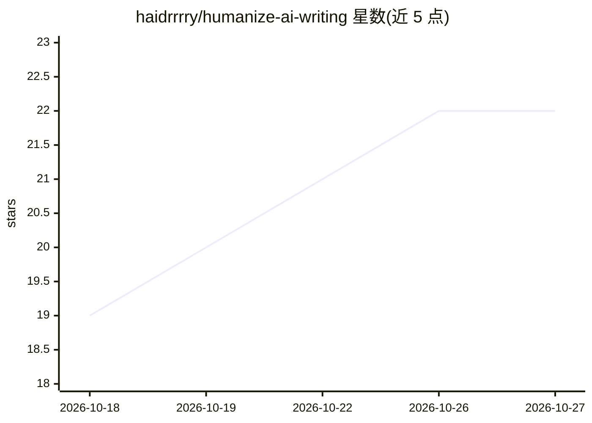

# haidrrrry/humanize-ai-writing

⭐ 22 · JavaScript · MIT · 推送 2026-07-01 · [GitHub](https://github.com/haidrrrry/humanize-ai-writing) · [官网](https://instagram.com/haidercodes) · 个人维护

**让 ChatGPT/Claude 等聊天模型写出类人文风的系统提示词与技能**

一套 MIT 许可的可移植规则集：以 PROMPT.md 形式粘贴进 ChatGPT、Gemini、Grok、Kimi、DeepSeek 等工具的自定义指令，或以 Claude 技能形式一键安装到 Claude Code/Desktop。规则源自 Wikipedia 的 AI 写作迹象条目，禁用约 40 种 AI 文风特征（delve、tapestry、破折号滥用等），共 12 条规则。另附零依赖的 Node CLI 检查器，可扫描文本标记 AI 痕迹并接入 CI。README 明确声明不承诺完全绕过 AI 检测器。

## 筛选速览

| 维度 | 判定 | 备注 |
|---|---|---|
| AI 角色 | `ai-knowledge` | 知识聚合/清单类 |
| 许可风险 | `permissive` | MIT |
| 部署形态 | `library` | 以包/库形式分发 |
| 模型依赖 | locked-api |  |
| 硬件要求 | — | 无带数字的原话,不猜 |
| 安装摩擦 | `low` | 无编译、无系统依赖或容器化 |
| 成熟度 | — | 结构信号不足 |

## 能力要点

- 同一规则集支持 20+ 工具：粘贴式提示词 + Claude 原生技能
- 12 条规则映射 Wikipedia 的 AI 写作迹象目录
- 零依赖 CLI 检查器（npx 可直接运行），非零退出码可接入 CI/pre-commit
- 提供 INSTALL-FOR-AI.md 让具备文件访问能力的 AI 工具自行安装

## 适用场景

- 让 AI 写出的文案减少机器味词汇与句式
- 在写作流程中用 CLI 扫描草稿的 AI 痕迹
- 为 Claude Code 配置自动触发的人文风技能

## 场景标签

`提示工程` `AI 写作` · 领域:Agent 开发

## 证据(README 行号)

> L9: A free, open-source system prompt and AI skill that forces any chatbot — **ChatGPT, Claude, Gemini, Grok, Kimi, Deep
> L23: **Humanize AI Writing** is a portable ruleset you paste into any AI tool. After that, the AI avoids the ~40 known t
> L77: - **Sourced, not vibes.** Rules map directly to Wikipedia's "Signs of AI writing", with a fix and before/after for 

## 星数曲线

2026-10-18 19 → 2026-10-27 22（+3）

---
*卡片 v1 · prompt 1.4 · 生成 2026-10-27 · 置信度 high · 依据 README sha `66e3ab6883cc` · [字段定义](../../DATASET.md)*
