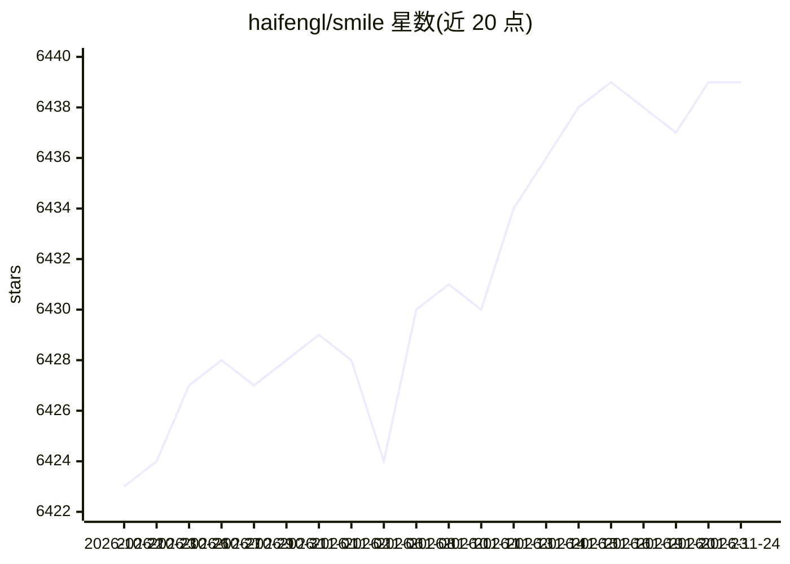

# haifengl/smile

⭐ 6,439 · Java · NOASSERTION · 推送 2026-11-22 · [GitHub](https://github.com/haifengl/smile) · [官网](https://haifengl.github.io) · 组织维护

**JVM 平台的机器学习与 LLM 推理引擎库**

面向 JVM 的机器学习与 AI 平台，基于 Java 25，提供 Kotlin/Scala API。核心引擎可在 Java/Scala/Kotlin 进程内直接调用分类、回归、聚类、流形学习、时间序列、NLP、深度学习等数百种算法；SMILE Serve 为基于 Quarkus 的推理服务器，统一提供经典 ML 模型、ONNX 模型与 OpenAI 兼容的 LLM 聊天接口；另含 Agent Studio 桌面工作区与数据处理（CSV/JSON/Parquet 等）模块。默认纯 JVM 运行，原生加速（OpenBLAS/LAPACK、ONNX Runtime、LibTorch/CUDA）为可选。商业许可由 HALO.AI 提供，移除 copyleft 义务。

## 筛选速览

| 维度 | 判定 | 备注 |
|---|---|---|
| AI 角色 | `ai-native` | 本体是模型或模型工具 |
| 许可风险 | `none` | NOASSERTION |
| 部署形态 | `desktop` | 安装包/桌面程序 |
| 模型依赖 | — | README 未给出锁定关系 |
| 硬件要求 | — | 无带数字的原话,不猜 |
| 安装摩擦 | `medium` | 含编译或系统依赖之一 |
| 成熟度 | — | 结构信号不足 |

## 能力要点

- 核心引擎数百种算法覆盖分类/回归/聚类/流形/NLP/时间序列等
- SMILE Serve 统一推理服务器：经典 ML、ONNX、OpenAI 兼容 LLM 接口
- 进程内 TreeSHAP 与 KernelSHAP 特征归因解释
- 支持 DeepSeek、MiniMax、Qwen、LLaMA 等模型的本地 LLM 推理

## 适用场景

- 在 JVM 微服务或边缘设备上内嵌模型训练与预测
- 自托管部署多模态 LLM 推理服务
- 对高风险决策提供 SHAP 级模型解释
- 数据管道中的 DataFrame 处理与统计分析

## 场景标签

`推理引擎` `模型训练` · 领域:训练与推理

## 证据(README 行号)

> L7: high-performance machine learning and AI platform for the JVM. Built on **Java 25**
> L31: - **Comprehensive Breadth in One Engine:** Hundreds of algorithms spanning classification, regression, clustering, 
> L42: A production-ready, Quarkus-based inference server (available as JVM, CUDA GPU, and GraalVM native containers) that

## 星数曲线

2026-10-22 6,423 → 2026-11-24 6,439（+16）

---
*卡片 v1 · prompt 1.4 · 生成 2026-11-22 · 置信度 mid · 依据 README sha `332e0bec3e53` · [字段定义](../../DATASET.md)*
