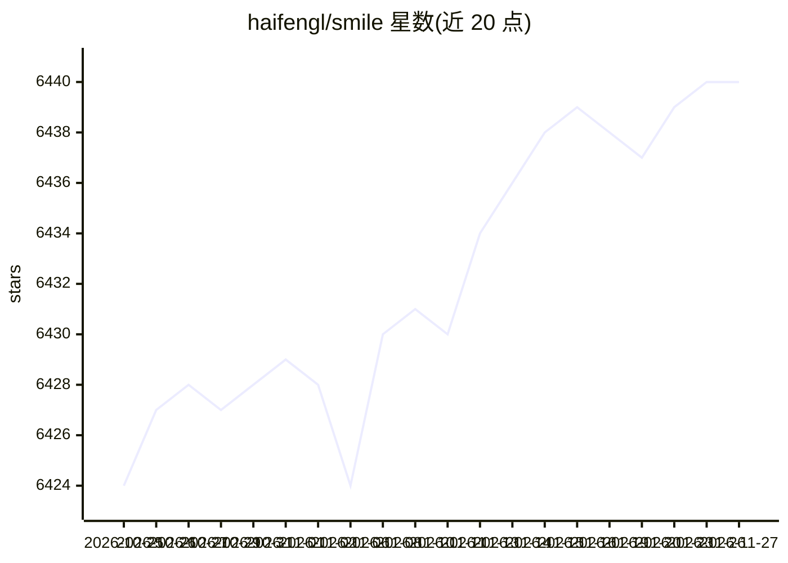

# haifengl/smile

⭐ 6,440 · Java · NOASSERTION · 推送 2026-11-26 · [GitHub](https://github.com/haifengl/smile) · [官网](https://haifengl.github.io) · 组织维护

**JVM 平台的机器学习与 LLM 推理引擎及推理服务器**

面向 JVM 的机器学习与 AI 平台，提供数百种经典 ML 算法（分类、回归、聚类、流形学习、时间序列、NLP 等）、LibTorch/ONNX 深度学习后端与 DeepSeek/Qwen/Llama 等模型的本地 LLM 推理。包含三大组成部分：进程内嵌入的核心引擎、基于 Quarkus 的 SMILE Serve 推理服务器（含 OpenAI 兼容接口与 Prometheus 指标）、带多 Agent 团队与 IDE 的 Agent Studio。支持 SHAP 可解释性、agentic AutoML 与模型热替换。商业许可由 HALO.AI 提供。

## 筛选速览

| 维度 | 判定 | 备注 |
|---|---|---|
| AI 角色 | `ai-native` | 本体是模型或模型工具 |
| 许可风险 | `none` | NOASSERTION |
| 部署形态 | `desktop` | 安装包/桌面程序 |
| 模型依赖 | — | README 未给出锁定关系 |
| 硬件要求 | — | 无带数字的原话,不猜 |
| 安装摩擦 | `medium` | 含编译或系统依赖之一 |
| 成熟度 | — | 结构信号不足 |

## 能力要点

- 覆盖经典 ML、深度学习与本地 LLM 推理的统一引擎
- SMILE Serve 提供 OpenAI 兼容 chat 接口、ONNX 推理与 Prometheus 指标
- TreeSHAP 与 KernelSHAP 进程内可解释性
- 可在边缘设备上训练与更新模型（Random Forests、GBDT、K-Means 等）

## 适用场景

- 在 JVM 微服务或边缘节点内嵌机器学习推理，避免云端往返
- 自托管部署 LLM chat 服务（OpenAI 兼容 API）
- 用 Java/Scala/Kotlin 直接调用经典机器学习算法库
- 通过 Agent Studio 的桌面工作区运行多 Agent 协作任务

## 场景标签

`推理引擎` `多智能体` · 领域:Agent 开发

## 证据(README 行号)

> L6: SMILE (**Statistical Machine Intelligence & Learning Engine**) is a comprehensive,
> L11: application, and serving classical ML, ONNX graphs, and LLMs on your own machines.
> L41: #### 2. SMILE Serve: Unified Inference Runtime

## 星数曲线

2026-10-25 6,424 → 2026-11-27 6,440（+16）

---
*卡片 v1 · prompt 1.4 · 生成 2026-11-24 · 置信度 high · 依据 README sha `76cc8ac4b1d4` · [字段定义](../../DATASET.md)*
