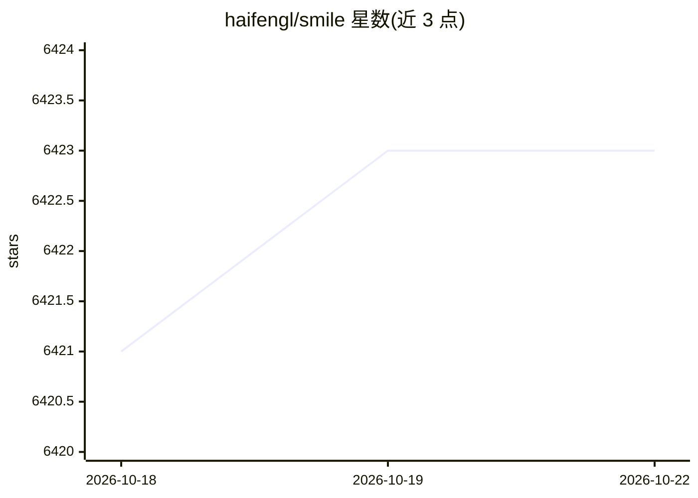

# haifengl/smile

⭐ 6,423 · Java · NOASSERTION · 推送 2026-10-21 · [GitHub](https://github.com/haifengl/smile) · [官网](https://haifengl.github.io) · 个人维护

**面向 JVM 的机器学习框架，覆盖经典 ML、深度学习与 LLM 推理**

SMILE 是 JVM 上的机器学习框架，以 Java/Scala/Kotlin API 提供分类、回归、聚类、流形学习、NLP、数值方法与可视化等算法。深度学习模块基于 LibTorch 后端（GPU/CPU 张量、自定义层），LLM 模块含 LLaMA-3/Qwen3.5 推理栈、tiktoken 分词器、连续批处理推理引擎、KV 缓存与量化/张量并行。另有 SMILE Serve（Quarkus 推理服务器，OpenAI 兼容 API）、SMILE Studio（数据科学桌面 IDE）及 Spark 集成模块。v5+ 需 Java 25；部分算法依赖 BLAS/LAPACK 本地库。

## 筛选速览

| 维度 | 判定 | 备注 |
|---|---|---|
| AI 角色 | `ai-native` | 本体是模型或模型工具 |
| 许可风险 | `none` | NOASSERTION |
| 部署形态 | `desktop` | 安装包/桌面程序 |
| 模型依赖 | — | README 未给出锁定关系 |
| 硬件要求 | — | 无带数字的原话,不猜 |
| 安装摩擦 | `medium` | 含编译或系统依赖之一 |
| 成熟度 | — | 结构信号不足 |

## 能力要点

- JVM 全栈 ML 算法库：分类/回归/聚类/流形学习/NLP/数值方法
- LibTorch 后端深度学习与 EfficientNet-V2 图像分类
- smile.llm：LLaMA-3/Qwen3.5 推理、连续批处理、KV 缓存、FP8/NVFP4 量化
- SMILE Serve 提供 OpenAI 兼容推理服务与 React Web UI

## 适用场景

- 在 Java/Scala/Kotlin 项目中使用机器学习与深度学习算法
- 在 JVM 上运行 LLaMA-3/Qwen3.5 本地 LLM 推理
- 通过 SMILE Serve 部署 OpenAI 兼容的模型推理服务
- 在 Spark ML 管道中训练和评分 SMILE 模型

## 场景标签

`推理引擎` · 领域:训练与推理

## 证据(README 行号)

> L6: SMILE (Statistical Machine Intelligence & Learning Engine) is a comprehensive,
> L35: |**LLM**|LLaMA-3 inference, tiktoken BPE tokenizer, OpenAI-compatible REST server, SSE chat streaming|
> L111: |LLM.md|`smile.llm` — tokenizer, LLaMA-3, Qwen3.5, inference engine, KV cache, quantization, tensor parallelism|

## 星数曲线

2026-10-18 6,421 → 2026-10-22 6,423（+2）

---
*卡片 v1 · prompt 1.4 · 生成 2026-10-20 · 置信度 high · 依据 README sha `8148e0ed3736` · [字段定义](../../DATASET.md)*
