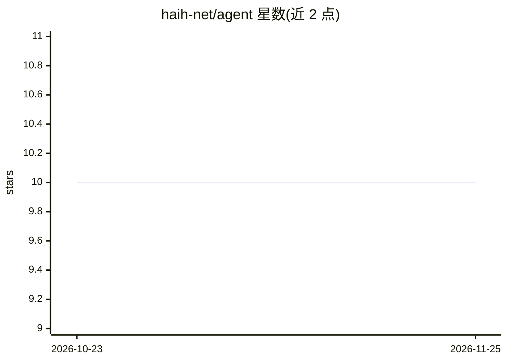

# haih-net/agent

⭐ 10 · TypeScript · MIT · 推送 2026-09-26 · [GitHub](https://github.com/haih-net/agent) · [官网](https://agent.haih.net) · 个人维护

**自托管全栈自主 AI Agent 平台：独立身份与知识管理**

全栈自托管平台，构建具有自身身份与凭证的自主 AI 实体：Agent 以独立参与者身份认证、追踪自身知识及置信度，每次工具调用必须携带 reasoning 字段以留下审计轨迹。技术栈为 Next.js 16、Apollo GraphQL、Prisma、PostgreSQL，n8n 作为工作流运行时但工作流由 TypeScript 代码生成。支持 OpenRouter API 或本地 llama.cpp（需 NVIDIA GPU），另含计费、发文、图像识别与生成模块。安装方式为 Docker Compose 或 Node.js 本地开发，提供 AI 编码助手自动安装指引。

## 筛选速览

| 维度 | 判定 | 备注 |
|---|---|---|
| AI 角色 | `ai-native` | 本体是模型或模型工具 |
| 许可风险 | `permissive` | MIT |
| 部署形态 | `self-host` | docker 或自建部署 |
| 模型依赖 | local-ok | 支持本地模型 |
| 硬件要求 | — | 无带数字的原话,不猜 |
| 安装摩擦 | `low` | 无编译、无系统依赖或容器化 |
| 成熟度 | `idea` | |

## 能力要点

- 每次工具调用强制携带 reasoning 字段，形成决策审计轨迹
- Agent 拥有独立凭证与权限，可通过 GraphQL 自省模式自主学习 API
- 认知知识库支持带置信度的 N 元事实、矛盾处理与知识空间分级
- 可选本地 llama.cpp 运行 LLM 与视觉模型，数据不出本机

## 适用场景

- 自托管一个具备独立身份与知识记忆的自主 Agent
- 研究认知架构与 Agent 决策过程的可审计设计
- 搭建归属自己的博客与内容发布平台
- 通过本地 GPU 运行 LLM 进行图像与图表分析

## 场景标签

`知识库管理` `Agent 框架` · 领域:Agent 开发

## 证据(README 行号)

> L3: **Autonomous AI entity, not a chatbot.** Own identity, own credentials, own knowledge. The agent authenticates as it
> L29: Every tool call requires a `reasoning` field — the agent must explain *why* it's taking this action before executin
> L59: Runs on your machine. Optional local LLM via llama.cpp (NVIDIA GPU). Your data stays local.

## 星数曲线

2026-10-23 10 → 2026-11-25 10（+0）

---
*卡片 v1 · prompt 1.4 · 生成 2026-11-19 · 置信度 high · 依据 README sha `68d2d8203734` · [字段定义](../../DATASET.md)*
