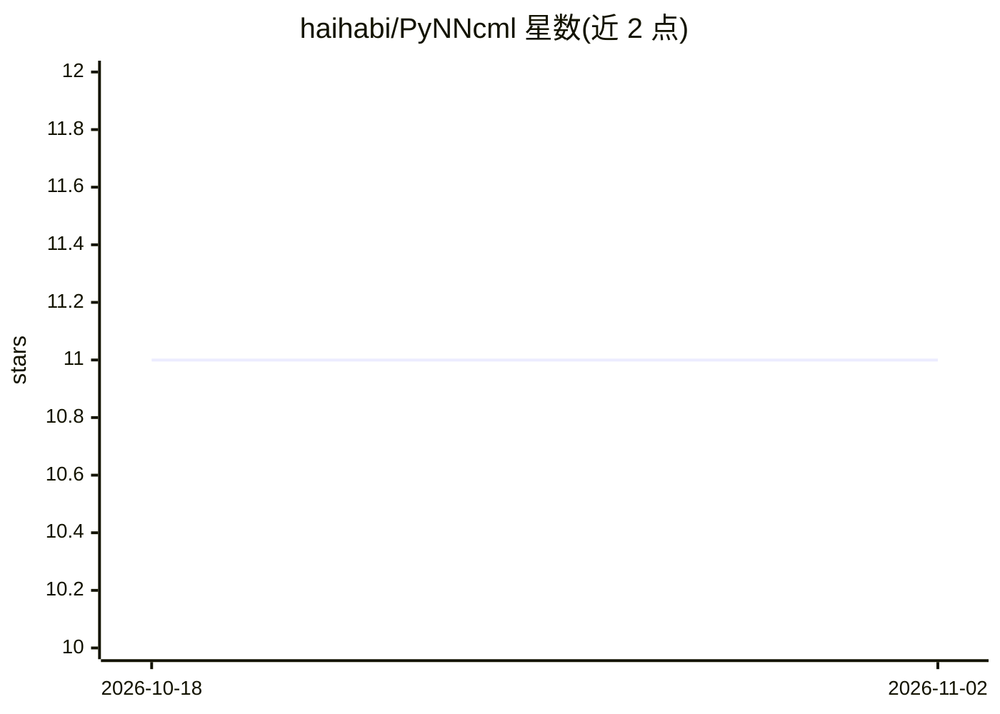

# haihabi/PyNNcml

⭐ 11 · Python · MIT · 推送 2026-10-04 · [GitHub](https://github.com/haihabi/PyNNcml) · 组织维护

**用神经网络从商用微波链路数据估计降雨的 PyTorch 库**

基于 PyTorch 的 Python 工具箱，读取商用微波链路（CML）衰减数据，执行干湿分类（RNN、STD 窗口）、降雨估计（常数/动态基线、直接 RNN 估计）与雨场生成/插值。附带两条链路的示例数据集、OpenMRG 数据集的 PyTorch 版本及性能指标实现；提供含干湿分类网络与一步/两步网络的 Model Zoo，训练数据不公开。起源于特拉维夫大学硕士论文，现由作者与该校实验室维护。

## 筛选速览

| 维度 | 判定 | 备注 |
|---|---|---|
| AI 角色 | `ai-native` | 本体是模型或模型工具 |
| 许可风险 | `permissive` | MIT |
| 部署形态 | `library` | 以包/库形式分发 |
| 模型依赖 | — | README 未给出锁定关系 |
| 硬件要求 | — | 无带数字的原话,不猜 |
| 安装摩擦 | `low` | 无编译、无系统依赖或容器化 |
| 成熟度 | — | 结构信号不足 |

## 能力要点

- RNN 干湿分类与多方法降雨估计
- 提供预训练网络 Model Zoo（不同 RNN 层数）
- 内置示例数据集与 OpenMRG 数据集 PyTorch 版本
- 包含性能与鲁棒性指标实现

## 适用场景

- 从微波链路数据中提取降雨量
- 构建 CML 降雨监测研究的基线与对比实验
- 学习 CML 降雨估计算法的示例与教程

## 场景标签

`教程课程` `科研工具` · 领域:学习与行业

## 证据(README 行号)

> L2: A python toolbox based on PyTorch which utilized neural network for rain estimation and classification from commerci
> L29: 1. Wet Dry Classification (RNN[1,2,3] and STD Window[6])
> L30: 2. Rain Estimation (Constant Baseline [6], Dynamic Baseline [5], Direct RNN Estimation [4,3])

## 星数曲线

2026-10-18 11 → 2026-11-02 11（+0）

---
*卡片 v1 · prompt 1.4 · 生成 2026-11-02 · 置信度 high · 依据 README sha `c8e9aec9073d` · [字段定义](../../DATASET.md)*
