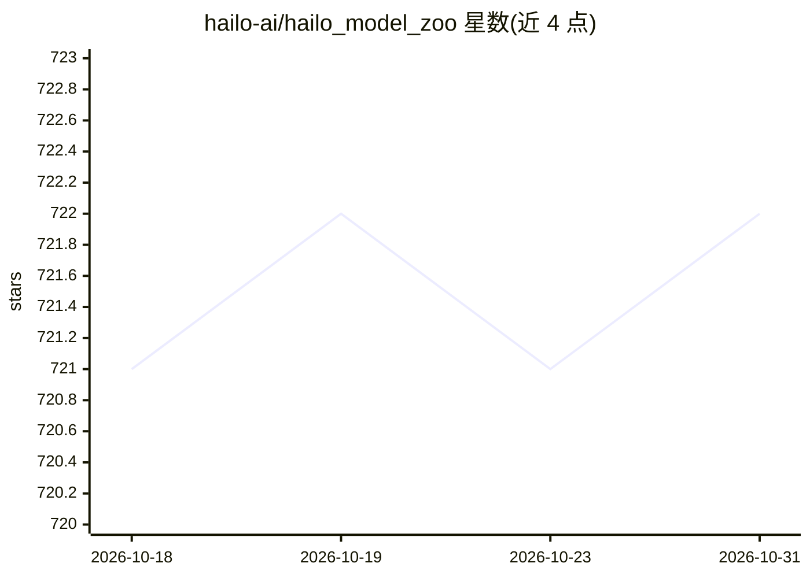

# hailo-ai/hailo_model_zoo

⭐ 722 · Python · MIT · 推送 2026-10-28 · [GitHub](https://github.com/hailo-ai/hailo_model_zoo) · 组织维护

**面向 Hailo 边缘芯片的预训练模型库与编译评测环境**

Hailo 公司维护的模型库：提供 ONNX/TF 格式预训练模型与预编译 HEF 二进制文件，覆盖分类、检测、分割等任务，适配 Hailo-10/15 设备（Hailo-8/8L 在 v2.x 分支）。基于 Hailo Dataflow Compiler 实现模型解析、优化量化、仿真评测与编译生成 HEF；另提供自定义数据集重训练指引。安装需先获取 Dataflow Compiler（非 Hailo 客户需联系官方），HailoRT 为可选。附带三个 Claude Code 技能引导 DFC 流程。

## 筛选速览

| 维度 | 判定 | 备注 |
|---|---|---|
| AI 角色 | `ai-ecosystem` | LLM/agent 周边工具 |
| 许可风险 | `permissive` | MIT |
| 部署形态 | `library` | 以包/库形式分发 |
| 模型依赖 | — | README 未给出锁定关系 |
| 硬件要求 | — | 无带数字的原话,不猜 |
| 安装摩擦 | `medium` | 含编译或系统依赖之一 |
| 成熟度 | — | 结构信号不足 |

## 能力要点

- 预训练模型 + 预编译 HEF 二进制，覆盖 Hailo-10/15 设备
- 解析→优化量化→编译 HEF→仿真/硬件评测的完整流程
- 自定义数据集重训练指引（公开模型与内部训练模型）
- 附带三个 Claude Code 技能引导 DFC 流程

## 适用场景

- 为 Hailo 边缘设备挑选并编译视觉模型
- 在部署前用仿真器测量量化后精度
- 在自有数据集上重训 Model Zoo 网络

## 场景标签

`模型量化` `模型评测` · 领域:评测与运维

## 证据(README 行号)

> L43: The Hailo Model Zoo provides pre-trained models for high-performance deep learning applications. Using the Hailo Mo
> L109: For full functionality please see the `INSTALLATION GUIDE <docs/GETTING_STARTED.rst>`_ page (full install instruct

## 星数曲线

2026-10-18 721 → 2026-10-31 722（+1）

---
*卡片 v1 · prompt 1.4 · 生成 2026-10-21 · 置信度 high · 依据 README sha `0fed0c02842d` · [字段定义](../../DATASET.md)*
