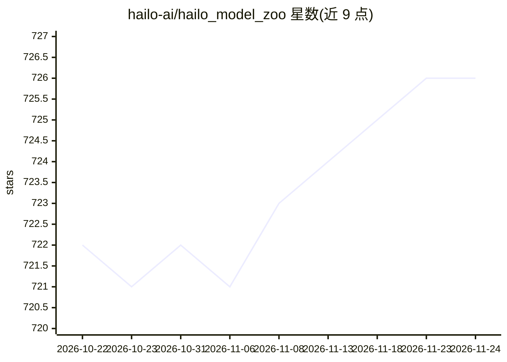

# hailo-ai/hailo_model_zoo

⭐ 726 · Python · MIT · 推送 2026-11-15 · [GitHub](https://github.com/hailo-ai/hailo_model_zoo) · 组织维护

**为 Hailo 加速硬件提供预训练模型与编译评估环境**

面向 Hailo 边缘 AI 芯片开发者的模型库与工具链：提供 ONNX/TF 格式预训练模型与预编译 HEF 二进制，支持全精度/量化精度评估（Hailo Emulator）与设备端推理评估，并通过 Hailo Dataflow Compiler 完成解析、优化、编译生成 HEF。附重训练指令以在自定义数据集上训练。以 git clone 加 pip 安装使用，依赖 DFC（需联系 Hailo 获取）。另附带三个 Claude Code skills 引导 parse/optimize/compile 流程。master 分支仅支持 Hailo-10/15 设备，Hailo-8 需使用 v2.x 分支。

## 筛选速览

| 维度 | 判定 | 备注 |
|---|---|---|
| AI 角色 | `ai-native` | 本体是模型或模型工具 |
| 许可风险 | `permissive` | MIT |
| 部署形态 | `library` | 以包/库形式分发 |
| 模型依赖 | — | README 未给出锁定关系 |
| 硬件要求 | — | 无带数字的原话,不猜 |
| 安装摩擦 | `medium` | 含编译或系统依赖之一 |
| 成熟度 | — | 结构信号不足 |

## 能力要点

- 提供 ONNX/TF 预训练模型与预编译 HEF 二进制
- 覆盖分类、检测、分割、跟踪、OCR、深度估计、句向量等多任务
- 提供自定义数据集重训练指令
- 附带 /hailo-parse、/hailo-optimize、/hailo-compile 三个 Claude Code skills

## 适用场景

- 为 Hailo-15/10 设备选型并评估预训练模型的量化精度
- 将自有 ONNX/TF 模型编译为可在 Hailo 硬件运行的 HEF
- 基于 Model Zoo 模型在自有数据集上重训练

## 场景标签

`模型量化` `微调` · 领域:训练与推理

## 证据(README 行号)

> L43: The Hailo Model Zoo provides pre-trained models for high-performance deep learning applications. Using the Hailo Mo
> L46: Hailo provides different pre-trained models in ONNX / TF formats and pre-compiled HEF (Hailo Executable Format) bin

## 星数曲线

2026-10-22 722 → 2026-11-24 726（+4）

---
*卡片 v1 · prompt 1.4 · 生成 2026-11-24 · 置信度 high · 依据 README sha `e947a8c32c03` · [字段定义](../../DATASET.md)*
