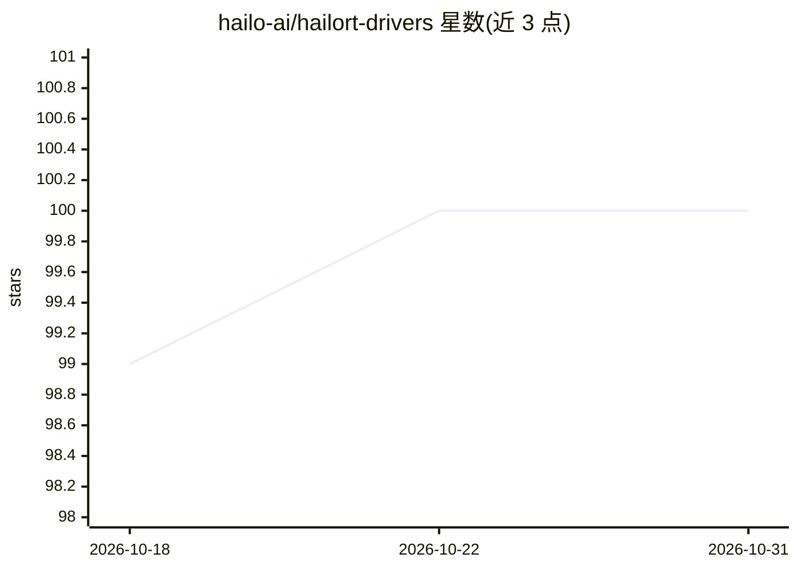

# hailo-ai/hailort-drivers

⭐ 100 · C · GPL-2.0 · 推送 2026-10-28 · [GitHub](https://github.com/hailo-ai/hailort-drivers) · [官网](https://hailo.ai/) · 组织维护

**供开发者通过 PCIe 接口与 Hailo AI 加速设备通信的内核驱动**

Hailo 官方维护的 Linux PCIe 驱动，负责管理 Hailo 设备、将 HailoRT 库连接到设备并在使用 PCIe 接口时加载设备固件，承担主机与设备间的数据传输。master 分支仅支持 Hailo-10 与 Hailo-15 设备家族；Hailo-8、Hailo-8R、Hailo-8L 需使用 hailo8 分支。编译与使用方法指向 hailo.ai 开发者文档，未在 README 内给出具体步骤。以 GPL-2.0 许可分发。

## 筛选速览

| 维度 | 判定 | 备注 |
|---|---|---|
| AI 角色 | `ai-ecosystem` | LLM/agent 周边工具 |
| 许可风险 | `viral` | GPL-2.0 |
| 部署形态 | `None` |  |
| 模型依赖 | — | README 未给出锁定关系 |
| 硬件要求 | — | 无带数字的原话,不猜 |
| 安装摩擦 | `low` | 无编译、无系统依赖或容器化 |
| 成熟度 | — | 结构信号不足 |

## 能力要点

- 连接 HailoRT 库与 Hailo 设备并加载设备固件
- 负责设备管理与主机-设备间数据传输
- master 分支支持 Hailo-10/15，hailo8 分支支持 Hailo-8 系列

## 适用场景

- 在装有 Hailo PCIe 加速卡的边缘设备上运行深度学习推理
- 为 HailoRT 软件栈提供 PCIe 层设备接入
- Hailo-8 系列旧设备通过 hailo8 分支获得驱动支持

## 场景标签

 · 领域:边缘 AI 硬件/驱动

## 证据(README 行号)

> L5: The Hailo PCIe driver is necessary for interacting with a Hailo device over the PCIe interface. It connects the **Ha
> L6: device's firmware when using this interface. The driver is responsible for managing the Hailo device, communicating 

## 星数曲线

2026-10-18 99 → 2026-10-31 100（+1）

---
*卡片 v1 · prompt 1.4 · 生成 2026-10-23 · 置信度 high · 依据 README sha `a47ed35dbd43` · [字段定义](../../DATASET.md)*
