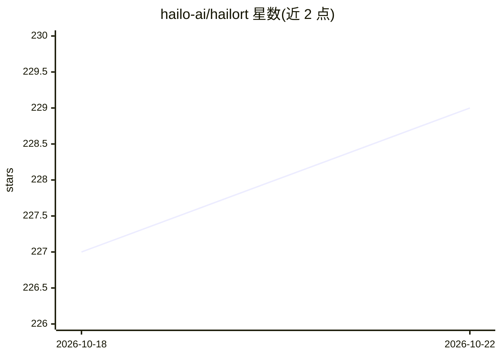

# hailo-ai/hailort

⭐ 229 · C++ · 推送 2026-10-13 · [GitHub](https://github.com/hailo-ai/hailort) · [官网](https://hailo.ai/) · 组织维护

**面向 Hailo 边缘 AI 加速芯片的推理运行时库**

HaloRT 是运行在主机处理器上的推理运行时库，通过用户空间 C/C++ API 与 Hailo AI 加速设备通信，用于运行推理、控制设备、采集统计与设备事件。组件含 HailoRT 库、CLI、PCIe 驱动（内含 Hailo-8 固件）、Python API（pyHailoRT）与 GStreamer 元素（HailoNet）。支持 Linux 和 Windows，可从源码编译以适配 x86 和 ARM 处理器；master 分支仅支持 Hailo-10/15 系列，Hailo-8 系列需用 hailo8 分支。

## 筛选速览

| 维度 | 判定 | 备注 |
|---|---|---|
| AI 角色 | `ai-ecosystem` | LLM/agent 周边工具 |
| 许可风险 | `none` | — |
| 部署形态 | `None` |  |
| 模型依赖 | — | README 未给出锁定关系 |
| 硬件要求 | — | 无带数字的原话,不猜 |
| 安装摩擦 | `low` | 无编译、无系统依赖或容器化 |
| 成熟度 | — | 结构信号不足 |

## 能力要点

- 提供 C/C++ 用户空间库与 CLI，运行推理并采集设备统计/事件
- 包含 PCIe 驱动与 Hailo-8 固件管理设备启动与通信
- pyHailoRT Python API 与 GStreamer 元素（HailoNet）
- 支持 Linux/Windows，可编译集成到 x86 与 ARM 处理器

## 适用场景

- 在 Hailo 边缘加速设备上部署和运行深度学习推理
- 通过 CLI 或 Python API 控制设备与采集运行数据
- 将 Hailo 推理接入 GStreamer 视频流水线

## 场景标签

 · 领域:边缘 AI 硬件/推理框架

## 证据(README 行号)

> L5: HailoRT is a lightweight, production-grade runtime library that runs on the host processor and provides a robust
> L10: - HailoRT CLI - a command line application used to control the Hailo device, run inferences, collect statistics and

## 星数曲线

2026-10-18 227 → 2026-10-22 229（+2）

---
*卡片 v1 · prompt 1.4 · 生成 2026-10-22 · 置信度 high · 依据 README sha `00cfc9167204` · [字段定义](../../DATASET.md)*
