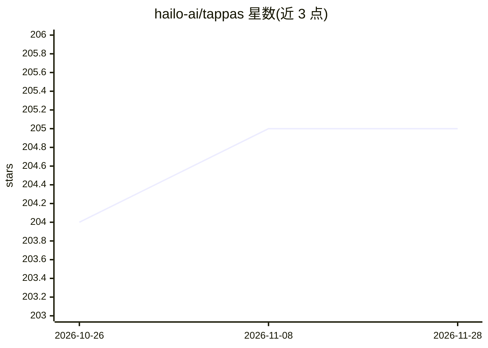

# hailo-ai/tappas

⭐ 205 · C++ · LGPL-2.1 · 推送 2026-10-26 · [GitHub](https://github.com/hailo-ai/tappas) · [官网](http://hailo.ai/) · 组织维护

**面向 Hailo 设备的视频 AI 管线构建基础设施**

Hailo TAPPAS 是 Hailo 的应用构建基础设施，提供管线元素与预训练 AI 任务实现，基于 GStreamer 构建视频处理管线。面向使用 Hailo-8/Hailo-10H 设备的开发者，用于缩短开发与部署周期、简化与 Hailo 运行时软件栈的集成，并作为应用微调的起点。需配备 Hailo 设备与 HailoRT PCIe 驱动，至少 6GB 磁盘空间；支持 Ubuntu x86/aarch64、Yocto 与 Raspberry Pi 5 安装；示例应用大多已迁移到 hailo-apps-infra 仓库。

## 筛选速览

| 维度 | 判定 | 备注 |
|---|---|---|
| AI 角色 | `ai-ecosystem` | LLM/agent 周边工具 |
| 许可风险 | `viral` | LGPL-2.1 |
| 部署形态 | `None` |  |
| 模型依赖 | — | README 未给出锁定关系 |
| 硬件要求 | — | 无带数字的原话,不猜 |
| 安装摩擦 | `medium` | 含编译或系统依赖之一 |
| 成熟度 | — | 结构信号不足 |

## 能力要点

- 基于 GStreamer 的管线元素与预训练 AI 任务基础设施
- 提供单流目标检测示例管线及 C++ 后处理元素编写指南
- 支持 SW Suite、手动、Yocto、Raspberry Pi 5 多种安装途径
- 附带调试、性能剖析与交叉编译文档

## 适用场景

- 在 Hailo-8/Hailo-10H 设备上搭建视频分析管线
- 评估 Hailo 设备的系统集成场景与参考实现
- 以示例代码为起点定制边缘视频 AI 应用

## 场景标签

`图像视频处理` `目标检测` · 领域:感知与多模态

## 证据(README 行号)

> L32: TAPPAS is Hailo's infrastructure for building applications, implementing pipeline elements and
> L97: TAPPAS includes a `single-stream object detection pipeline <apps/detection/README.rst>`_ built on top of GStreamer.
> L49: * Hailo-8 or Hailo-10H device

## 星数曲线

2026-10-26 204 → 2026-11-28 205（+1）

---
*卡片 v1 · prompt 1.4 · 生成 2026-11-25 · 置信度 high · 依据 README sha `5d2716a5d0a7` · [字段定义](../../DATASET.md)*
