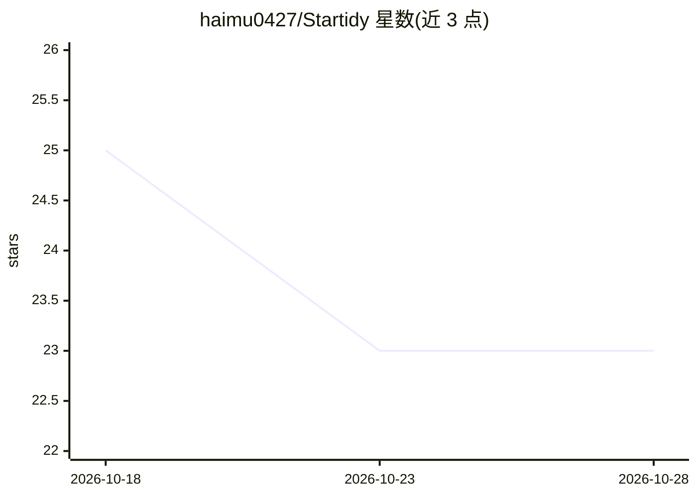

# haimu0427/Startidy

⭐ 23 · TypeScript · MIT · 推送 2026-10-03 · [GitHub](https://github.com/haimu0427/Startidy) · 个人维护 · 中文 README

**让 AI Agent 自动整理 GitHub Stars 到 Lists 的契约驱动 CLI**

面向使用 Claude Code、Cursor、Codex 等 AI 终端的开发者：以 npm CLI（snapshot/preview/apply 等命令）负责抓取 Stars 快照、校验与执行变更，由外部 AI Agent 负责语义理解与分类规划；通过 JSON Schema 契约校验输入输出，采用快照→预览→确认后应用的三阶段流程，支持断点续传。需 Node.js >= 22 与已登录的 GitHub CLI (gh)，v2 版本不再需要配置外部大模型 API。

## 筛选速览

| 维度 | 判定 | 备注 |
|---|---|---|
| AI 角色 | `ai-ecosystem` | LLM/agent 周边工具 |
| 许可风险 | `permissive` | MIT |
| 部署形态 | `library` | 以包/库形式分发 |
| 模型依赖 | — | README 未给出锁定关系 |
| 硬件要求 | — | 无带数字的原话,不猜 |
| 安装摩擦 | `low` | 无编译、无系统依赖或容器化 |
| 成熟度 | — | 结构信号不足 |

## 能力要点

- Agent + 契约驱动：JSON Schema 严格校验，AI 只出方案、CLI 执行
- Snapshot → Preview → Apply 三阶段安全流程，用户确认后才应用
- 提供可挂载到 Claude Code / Codex / Cursor 等的标准化 Agent Skill
- startidy CLI 提供 doctor/snapshot/details/preview/apply/status/resolve 七个子命令

## 适用场景

- 让日常使用的 AI 助手自动把几百个 Star 归类到 GitHub Lists
- 在应用变更前人工审核分类方案的 diff 预览
- 恢复或处理中断的整理任务

## 场景标签

 · 领域:开发者工具/GitHub 管理

## 证据(README 行号)

> L33: 1. **Agent 负责大脑，CLI 负责手脚**：由日常使用的 ai agent 驱动，负责语义理解与分类规划。
> L80: Startidy 在 `skills/startidy/` 目录下提供了符合标准的 Agent Skill，支持各种主流 AI 终端：

## 星数曲线

2026-10-18 25 → 2026-10-28 23（-2）

---
*卡片 v1 · prompt 1.4 · 生成 2026-10-27 · 置信度 high · 依据 README sha `409f4ca8bc02` · [字段定义](../../DATASET.md)*
