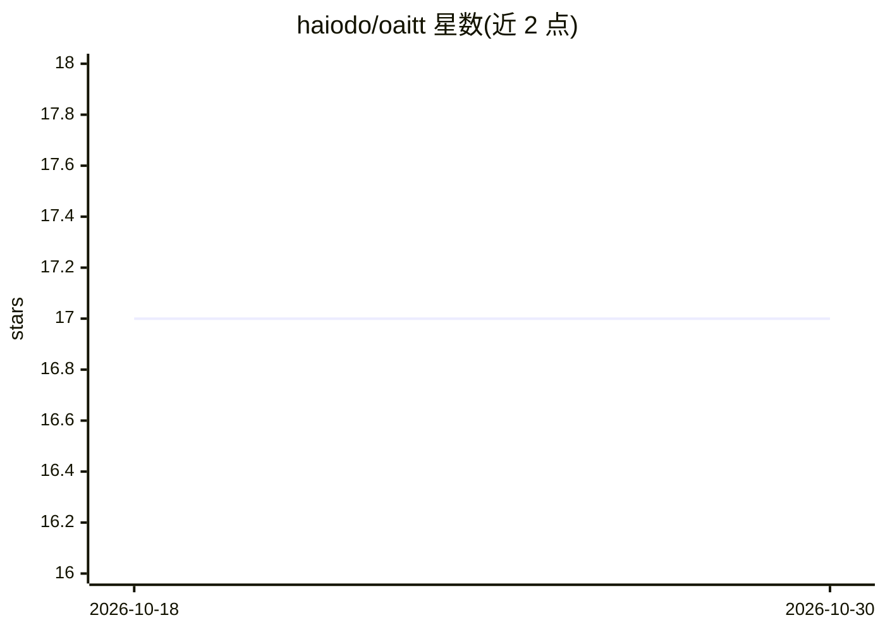

# haiodo/oaitt

⭐ 17 · Python · MIT · 推送 2026-10-18 · [GitHub](https://github.com/haiodo/oaitt) · 个人维护 · 中文 README

**OpenAI 兼容的本地语音转录服务，支持多 ASR 引擎**

提供 OpenAI Whisper API 兼容端点（/v1/audio/transcriptions）的语音识别服务，有两种实现：跨平台 Python 服务（macOS/Linux/Docker）和 Apple Silicon 上的 Swift+MLX 菜单栏应用。支持十种 ASR 引擎（GigaAM 各变体、Parakeet TDT v3、Whisper、WhisperX、onnx-asr 等），GigaAM Multilingual 覆盖俄/英/哈/吉/乌五种语言。macOS 应用以独立进程管理 worker、崩溃重启并记录请求统计。输出 JSON/SRT/VTT 等格式，提供词级时间戳与置信度指标。MIT 许可，个人维护。

## 筛选速览

| 维度 | 判定 | 备注 |
|---|---|---|
| AI 角色 | `ai-native` | 本体是模型或模型工具 |
| 许可风险 | `permissive` | MIT |
| 部署形态 | `self-host` | docker 或自建部署 |
| 模型依赖 | — | README 未给出锁定关系 |
| 硬件要求 | — | 无带数字的原话,不猜 |
| 安装摩擦 | `low` | 无编译、无系统依赖或容器化 |
| 成熟度 | — | 结构信号不足 |

## 能力要点

- OpenAI 兼容 API，可作为 OpenAI Whisper API 的 drop-in 替代
- 十种 ASR 引擎（GigaAM CTC/RNNT、Parakeet TDT v3、Whisper、WhisperX、onnx-asr 等）
- Python 服务与 Apple Silicon 原生 Swift/MLX 菜单栏应用两种实现，API 相同可互换
- 输出 JSON/SRT/VTT/TSV 多种格式，含词级时间戳与置信度

## 适用场景

- 在本地或自有服务器上运行 OpenAI 兼容的语音转录 API，替换外部服务
- 对俄语及中亚语言音频做带词级时间戳的转录
- 在 Apple Silicon Mac 上以菜单栏应用形式常驻提供转录服务

## 场景标签

`语音识别` · 领域:感知与多模态

## 证据(README 行号)

> L48: - **Десять ASR движков**: GigaAM Native, GigaAM MLX, GigaAM Swift (CTC и RNNT), GigaAM Multilingual MLX (Apple Sili
> L51: - **OpenAI-совместимый API**: Drop-in замена для OpenAI Whisper API

## 星数曲线

2026-10-18 17 → 2026-10-30 17（+0）

---
*卡片 v1 · prompt 1.4 · 生成 2026-10-29 · 置信度 mid · 依据 README sha `bb76122e2103` · [字段定义](../../DATASET.md)*
