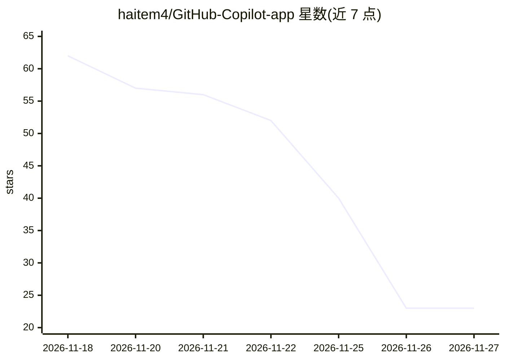

# haitem4/GitHub-Copilot-app

⭐ 23 · Apache-2.0 · 推送 2026-11-17 · [GitHub](https://github.com/haitem4/GitHub-Copilot-app) · 组织维护

**面向开发者的 GitHub Copilot 桌面端：管理、并行运行与落定代码 agent 工作流**

GitHub 官方的 agent-native 桌面应用，用于跨仓库查找、运行、引导和落地软件工作：本地会话运行于相互隔离的 git worktree，云会话运行在 GitHub 托管的隔离环境中；Canvases 将 agent 计划、终端、diff 与工作流状态呈现为可检查可编辑的界面；My Work 聚合会话、issue、PR 与仓库上下文，Automations 支持定时/后台任务，Agent Merge 辅助 PR 审查与合并。使用需 Git 与任一 Copilot 订阅（含免费版），或自带模型密钥（BYOK）。提供桌面安装包下载，许可为 GitHub, Inc. 保留所有权利（非开源许可）。

## 筛选速览

| 维度 | 判定 | 备注 |
|---|---|---|
| AI 角色 | `ai-ecosystem` | LLM/agent 周边工具 |
| 许可风险 | `permissive` | Apache-2.0 |
| 部署形态 | `desktop` | 安装包/桌面程序 |
| 模型依赖 | — | README 未给出锁定关系 |
| 硬件要求 | — | 无带数字的原话,不猜 |
| 安装摩擦 | `low` | 无编译、无系统依赖或容器化 |
| 成熟度 | — | 结构信号不足 |

## 能力要点

- 本地会话各自运行于隔离 git worktree，支持并行 agent 开发
- 云会话在 GitHub 托管隔离环境中运行，可随处接续
- Canvases 界面可视化 agent 计划、终端、diff 与进度并可中途改向
- 支持 BYOK 自带模型密钥，无 Copilot 订阅亦可使用

## 适用场景

- 并行派发多个 Copilot agent 处理 bug、issue 与审查反馈
- 在一个控制中心管理跨仓库的会话、issue 与 PR
- 将重复性提示与工作流设为定时或后台自动化任务

## 场景标签

`编码 Agent` `代码审查` · 领域:编码与开发

## 证据(README 行号)

> L3: The GitHub Copilot app is an agent-native desktop experience for finding, running, steering, and landing software wo
> L13: The GitHub Copilot app is an agent-native desktop experience for managing software work from idea to pull request. 
> L15: The app is built for parallel agent-driven development. Each local session runs in its own isolated git worktree, a

## 星数曲线

2026-11-18 62 → 2026-11-27 23（-39）

---
*卡片 v1 · prompt 1.4 · 生成 2026-11-18 · 置信度 high · 依据 README sha `ef82cf6db0cd` · [字段定义](../../DATASET.md)*
