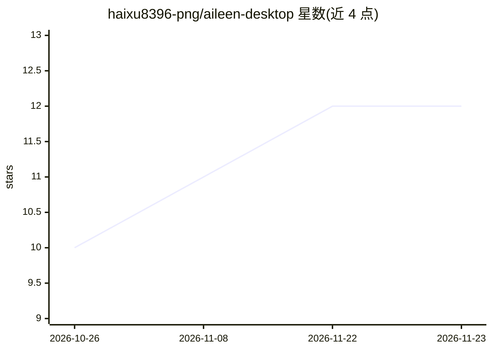

# haixu8396-png/aileen-desktop

⭐ 12 · JavaScript · NOASSERTION · 推送 2026-11-21 · [GitHub](https://github.com/haixu8396-png/aileen-desktop) · [官网](https://github.com/haixu8396-png/aileen-desktop/releases/latest) · 个人维护 · 中文 README

**Windows 桌面 AI 伙伴：Live2D 角色、多模型对话与电脑控制**

Electron 应用，将 AI 对话、角色卡系统、长期记忆、本地知识库、工具调用与电脑操作整合为一个桌面环境。角色卡驱动提示词组装，记忆与知识经嵌入模型检索并纳入预算化请求；Agent 按三级风险权限执行工具（文件读写、白名单命令、git、鼠标键盘），每步需人工批准。无账号、无托管后端，API 密钥仅在主进程使用，数据留在本机。以 Windows 安装包/便携版发布，源码可 npm 运行。

## 筛选速览

| 维度 | 判定 | 备注 |
|---|---|---|
| AI 角色 | `ai-native` | 本体是模型或模型工具 |
| 许可风险 | `none` | NOASSERTION |
| 部署形态 | `desktop` | 安装包/桌面程序 |
| 模型依赖 | local-ok | 支持本地模型 |
| 硬件要求 | — | 无带数字的原话,不猜 |
| 安装摩擦 | `low` | 无编译、无系统依赖或容器化 |
| 成熟度 | `idea` | |

## 能力要点

- 多 provider LLM 支持（含本地 Ollama）与角色卡系统
- 本地记忆与知识库，嵌入检索退化为关键词匹配时仍可完全离线
- 三级风险权限的工具调用与逐步批准的电脑控制
- Live2D 角色（Cubism 2/3/4）与桌面穿透悬浮舞台、Minecraft、棋类环境

## 适用场景

- 在桌面上养一个有 Live2D 形象、能说话有记忆的 AI 角色
- 让角色代理执行文件操作、跑命令、截屏问答等桌面任务
- 给 Minecraft 服务器加一个有性格的对话 bot
- 本地导入文档建知识库，与角色对话检索内容

## 场景标签

`AI 助手` `Agent 记忆` `RAG` `GUI 自动化` · 领域:Agent 开发

## 证据(README 行号)

> L23: AILEEN is a Windows desktop application that brings AI conversation, a character system, long-term memory, tool cal
> L29: - **AI conversation and character system** — character cards (personality, scenario, greeting, example dialogue), p

## 星数曲线

2026-10-26 10 → 2026-11-23 12（+2）

---
*卡片 v1 · prompt 1.4 · 生成 2026-11-18 · 置信度 high · 依据 README sha `dd9356279eb0` · [字段定义](../../DATASET.md)*
