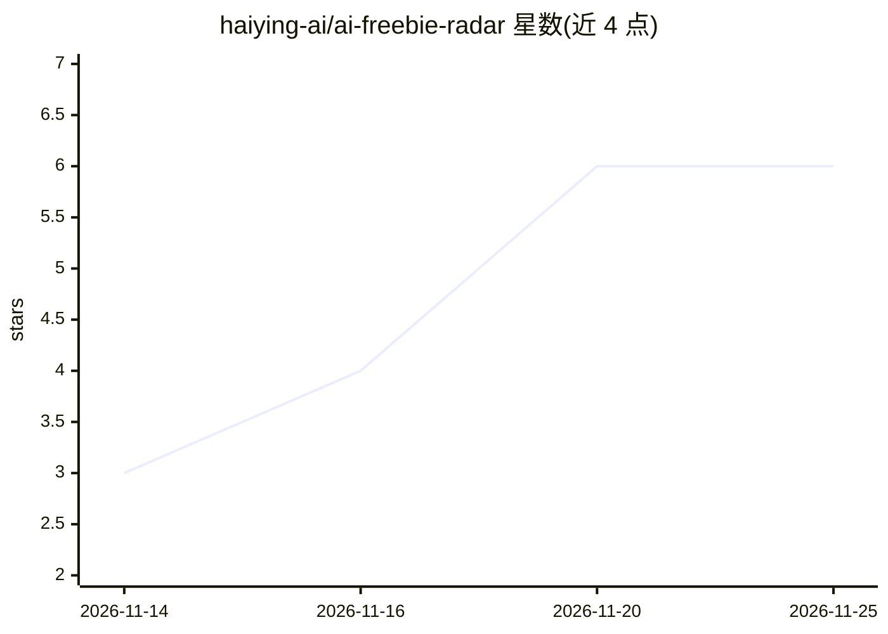

# haiying-ai/ai-freebie-radar

⭐ 6 · JavaScript · MIT · 推送 2026-11-20 · [GitHub](https://github.com/haiying-ai/ai-freebie-radar) · [官网](https://ai-credit-hub-44763.app.workbuddy.host/?sharecode=RIOZLFZCRN) · 个人维护 · 中文 README

**给 AI 用户聚合各平台免费额度并每日核验的雷达站**

聚合 50+ AI 平台官方公开的免费额度、GPU 算力与 API 配额信息：服务端定时任务每日逐条核验活动链接状态，失效自动下架，进行中的活动标注额度、有效期与领取方式。支持五维筛选、收录申请带 token 审批、管理后台、Canvas 分享海报与每日日报；Node.js 原生 http 实现，零框架，生产依赖仅 2 个，支持 VPS、静态托管与 Serverless 多种部署，数据库不可用时回退静态快照。

## 筛选速览

| 维度 | 判定 | 备注 |
|---|---|---|
| AI 角色 | `ai-knowledge` | 知识聚合/清单类 |
| 许可风险 | `permissive` | MIT |
| 部署形态 | `library` | 以包/库形式分发 |
| 模型依赖 | — | README 未给出锁定关系 |
| 硬件要求 | — | 无带数字的原话,不猜 |
| 安装摩擦 | `low` | 无编译、无系统依赖或容器化 |
| 成熟度 | — | 结构信号不足 |

## 能力要点

- 每日定时逐条核验 50+ 平台活动，失效自动下架
- 一键导出全静态站，可托管到 EdgeOne Pages / GitHub Pages
- 数据库不可用时前端自动回退静态快照
- 收录申请走带 token 的审批链接，无需登录后台

## 适用场景

- 一站式查看当前有效的各平台免费 AI 额度
- 私有化部署后每天自动同步免费资源数据
- 以纯静态形态免费托管一个信息聚合站

## 场景标签

 · 领域:AI 资源信息聚合

## 证据(README 行号)

> L3: **每天自动核验更新 50+ AI 平台的免费额度，一页看全，到期自动下架。**
> L28: **AI 资源白嫖雷达把这个过程自动化了**：云端定时任务每天核验收录的活动状态，失效自动下架，进行中的活动一页看全，每条标注额度、有效期、领取方式和最后核验时间。
> L37: |⏰ **每日自动同步**|服务端内置定时任务（默认 09:30），逐条核验活动链接与状态，到期自动置为已失效|

## 星数曲线

2026-11-14 3 → 2026-11-25 6（+3）

---
*卡片 v1 · prompt 1.4 · 生成 2026-11-20 · 置信度 high · 依据 README sha `03a1009c99a6` · [字段定义](../../DATASET.md)*
