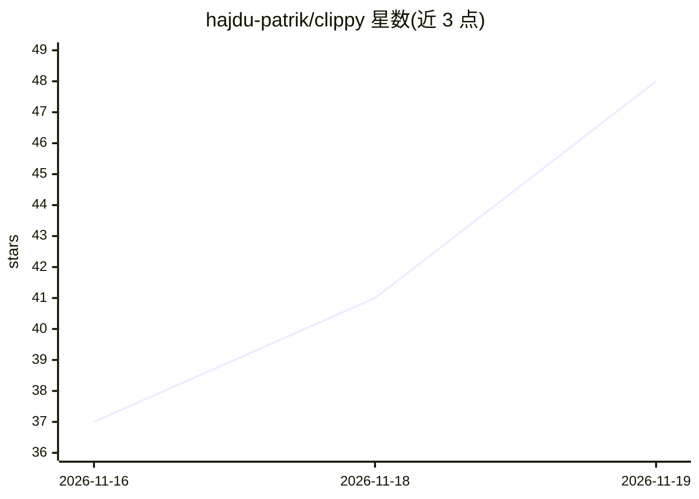

# hajdu-patrik/clippy

⭐ 48 · Python · NOASSERTION · 推送 2026-11-18 · [GitHub](https://github.com/hajdu-patrik/clippy) · [官网](https://hajdu-patrik.github.io/clippy/) · 个人维护

**本地 AI 剪辑工具：长视频/播客进，竖屏 9:16 带字幕短视频出**

在用户本机运行的 AI 视频剪辑应用：粘贴 YouTube/TikTok/Twitch 等链接，经 yt-dlp 下载、Demucs 人声分离、Whisper large-v3 转录、Qwen3-14B（经 Ollama 本地运行）打分挑选高光片段，自动剪切、人脸跟踪取景、生成逐字动画字幕并按手机标准处理音频；后续剪辑通过对话完成（LLM 将请求转为经验证的操作列表）。以 Web 应用与 CLI 双形式提供，支持直接发布到 YouTube/Instagram/TikTok。需 Python 3.12、Node.js 或 Deno、Ollama；建议 NVIDIA GPU 12-16 GB 显存，也可 CPU 运行。

## 筛选速览

| 维度 | 判定 | 备注 |
|---|---|---|
| AI 角色 | `ai-native` | 本体是模型或模型工具 |
| 许可风险 | `none` | NOASSERTION |
| 部署形态 | `library` | 以包/库形式分发 |
| 模型依赖 | local-ok | 支持本地模型 |
| 硬件要求 | — | 无带数字的原话,不猜 |
| 安装摩擦 | `medium` | 含编译或系统依赖之一 |
| 成熟度 | — | 结构信号不足 |

## 能力要点

- 本地 LLM（Ollama 运行 Qwen3-14B）评分挑选片段并全局重排
- Whisper large-v3 转录 + 逐字对齐动画字幕，按视频原语言输出
- 对话式剪辑：自然语言请求转为编辑操作，带变更卡片与一键撤销
- 一键安装脚本（Windows/macOS/Linux）自动配置环境、GPU 包与 Ollama

## 适用场景

- 把长视频、播客或直播录像转成 TikTok/Shorts/Reels 竖屏短视频
- 在对话中调整字幕、剪辑点、贴纸、音效和格式而无需手动剪辑
- 本地处理视频，不上传、无订阅，直接发布到三大短视频平台

## 场景标签

`图像视频处理` · 领域:感知与多模态

## 证据(README 行号)

> L23: * **picks the moments with the strongest hooks** with a local LLM (Qwen3-14B through Ollama), ranked against each o
> L84: link ─► yt-dlp (≤4K SDR + Opus) ─► Demucs voice isolation ─► Whisper large-v3 (hotwords, the video's own language) 
> L174: The microphone button next to Send turns your speech into the message (a small Whisper model on the CPU, so it nev

## 星数曲线

2026-11-16 37 → 2026-11-19 48（+11）

---
*卡片 v1 · prompt 1.4 · 生成 2026-11-18 · 置信度 mid · 依据 README sha `ddf1c3854645` · [字段定义](../../DATASET.md)*
