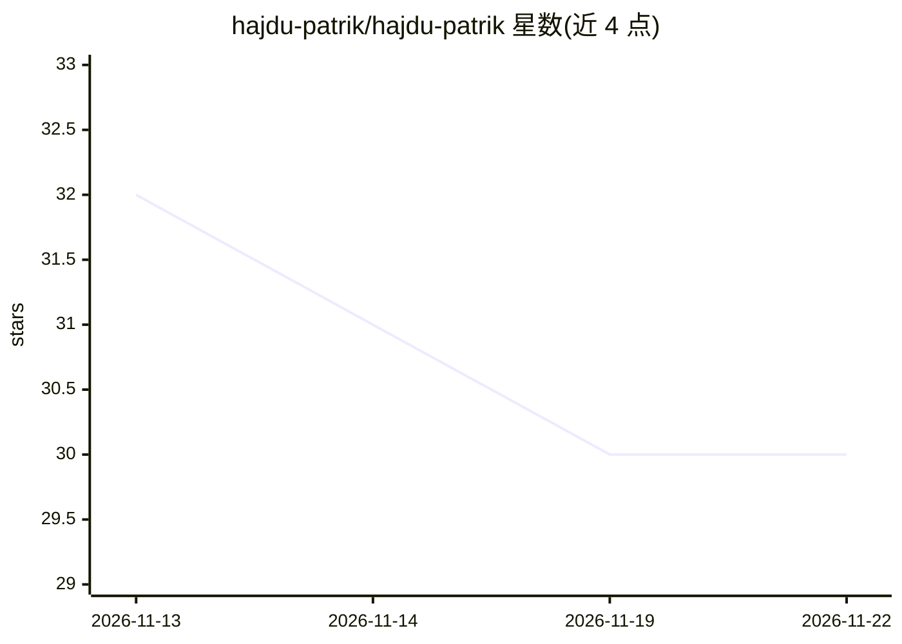

# hajdu-patrik/hajdu-patrik

⭐ 30 · 推送 2026-11-12 · [GitHub](https://github.com/hajdu-patrik/hajdu-patrik) · [官网](https://www.linkedin.com/in/hajdu-patrik/) · 个人维护

**个人开发者自我介绍主页：DevAiOps 工程师履历与项目展示**

这是 Patrik Zsolt Hajdú 的 GitHub 个人 README，介绍其身份（DATAGROUP 的 DevAiOps 工程师、BME 计算机工程学生）与技术方向（基础设施自动化与 AI 交叉领域）。重点展示其创办的 MaKoncert：匈牙利现场演出的非营利聚合平台，含演出日历、艺术家提醒、Spotify/YouTube Music 关联、robots.txt 合规的自动爬虫。末尾以徽章形式列举其掌握的语言、后端、DevOps 与 AI/LLM 工具栈。本仓库为个人主页，不含可安装运行的软件。

## 筛选速览

| 维度 | 判定 | 备注 |
|---|---|---|
| AI 角色 | `ai-knowledge` | 知识聚合/清单类 |
| 许可风险 | `none` | — |
| 部署形态 | `None` |  |
| 模型依赖 | — | README 未给出锁定关系 |
| 硬件要求 | — | 无带数字的原话,不猜 |
| 安装摩擦 | `medium` | 含编译或系统依赖之一 |
| 成熟度 | — | 结构信号不足 |

## 能力要点

- 个人履历页：DevAiOps 工程师与计算机工程学生
- 展示自建自运营的非营利演出聚合平台 MaKoncert（makoncert.hu）
- 以徽章列举语言/后端/DevOps/AI 工具栈

## 适用场景

- 了解该开发者的技能栈与工作背景
- 查看其代表项目 MaKoncert 的功能与定位

## 场景标签

 · 领域:个人主页/作品集

## 证据(README 行号)

> L3: **DevAiOps Engineer | Computer Engineering Student | Founder of MaKoncert**
> L13: ## 🎸 Featured Project: MaKoncert
> L98: #### 🤖 AI & LLMs

## 星数曲线

2026-11-13 32 → 2026-11-22 30（-2）

---
*卡片 v1 · prompt 1.4 · 生成 2026-11-18 · 置信度 low · 依据 README sha `2380040e29ea` · [字段定义](../../DATASET.md)*
