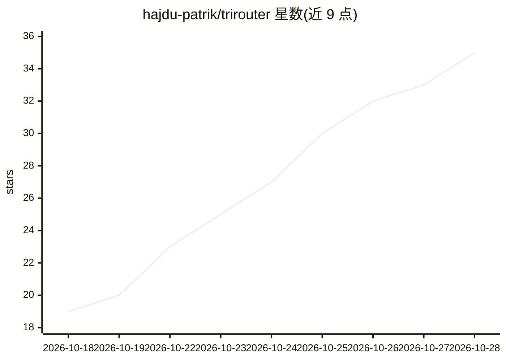

# hajdu-patrik/trirouter

⭐ 36 · Python · NOASSERTION · 推送 2026-10-28 · [GitHub](https://github.com/hajdu-patrik/trirouter) · 个人维护

**多 agent 编码工具的提示路由与编排系统**

在提示发送到 Claude Code、OpenAI Codex 或 Google Antigravity 之前拦截并决策：使用哪个模型与推理力度、可并行多少额外 agent（token 预算控制）、匹配哪个技能、是否为不可逆操作需确认、以何种语言回答。通过各工具的 hook 或 MCP 工具接入，模型/力度由生成的 worker agent 强制执行。路由决策来自 JEV（TypeSafe），无 key 时回退到内置本地分类器（对含错别字的真实流量较弱）。仅依赖 Python 标准库，git clone 后以 install.py 交互安装。

## 筛选速览

| 维度 | 判定 | 备注 |
|---|---|---|
| AI 角色 | `ai-ecosystem` | LLM/agent 周边工具 |
| 许可风险 | `none` | NOASSERTION |
| 部署形态 | `library` | 以包/库形式分发 |
| 模型依赖 | — | README 未给出锁定关系 |
| 硬件要求 | — | 无带数字的原话,不猜 |
| 安装摩擦 | `low` | 无编译、无系统依赖或容器化 |
| 成熟度 | — | 结构信号不足 |

## 能力要点

- 通过 hook/MCP 工具接入 Claude Code、Codex、Antigravity 并强制执行路由决策
- 每 (模型, 力度) 对生成一个 worker agent 以落实模型选择
- 共享 ~/.skills 技能目录，SkillSpector 静态扫描后跨工具链接
- 保护进行中的工作：新提示会被要求先完成前序任务
- JEV 不可用时回退本地分类器，零配置可用

## 适用场景

- 在不同编码 agent 工具间统一模型选择与成本控制
- 按提示难度自动升降模型档位（如 Sonnet 会话升级到 Opus worker）
- 让 Claude Code 与 Codex 共享同一技能文件夹

## 场景标签

`多智能体` `模型网关` · 领域:Agent 开发

## 证据(README 行号)

> L8: **trirouter** runs before every prompt you send to Claude Code, OpenAI Codex or Google Antigravity –
> L57: prompt ─► hook / MCP tool ─► trirouter/core.route()
> L65: |Claude Code (CLI, desktop *Code*, Remote Control)|`UserPromptSubmit`, `Stop`, `SessionStart`, `SubagentStart`, `Po

## 星数曲线

2026-10-18 19 → 2026-10-28 35（+16）

---
*卡片 v1 · prompt 1.4 · 生成 2026-10-26 · 置信度 high · 依据 README sha `7237deaa4035` · [字段定义](../../DATASET.md)*
