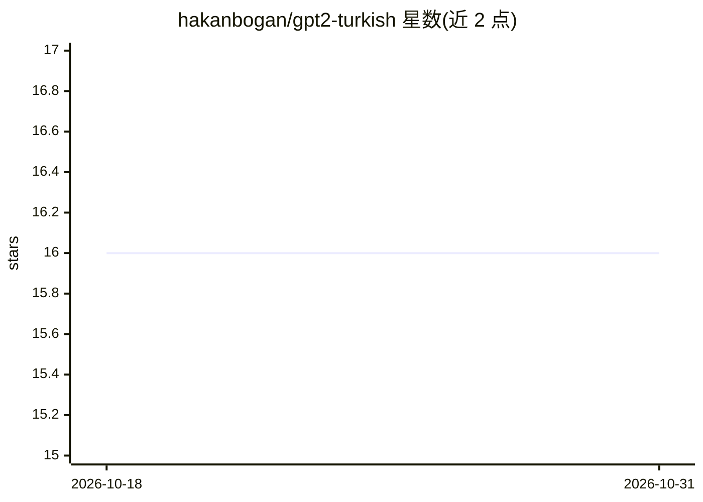

# hakanbogan/gpt2-turkish

⭐ 16 · MIT · 推送 2026-08-16 · [GitHub](https://github.com/hakanbogan/gpt2-turkish) · [官网](https://huggingface.co/redrussianarmy/gpt2-turkish-cased) · 个人维护

**土耳其语 GPT-2 预训练模型，作为后续微调的入口**

面向土耳其语 NLP 的 GPT-2 预训练模型权重发布：基于 oscar-corpus 土耳其语语料，用 Hugging Face Tokenizers 库构建 52K byte-level BPE 词表，在两块 2080TI 上以五个 epoch 完成训练。提供 PyTorch 与 TensorFlow 兼容权重及词表文件，通过 transformers 库 from_pretrained 加载，可用于 text-generation pipeline 或作为微调起点。权重托管于 Hugging Face，可用 git lfs 克隆。

## 筛选速览

| 维度 | 判定 | 备注 |
|---|---|---|
| AI 角色 | `ai-native` | 本体是模型或模型工具 |
| 许可风险 | `permissive` | MIT |
| 部署形态 | `None` |  |
| 模型依赖 | — | README 未给出锁定关系 |
| 硬件要求 | — | 无带数字的原话,不猜 |
| 安装摩擦 | `low` | 无编译、无系统依赖或容器化 |
| 成熟度 | — | 结构信号不足 |

## 能力要点

- 土耳其语语料训练的 GPT-2 权重（PyTorch/TensorFlow 双格式）
- 52K byte-level BPE 专用词表
- 提供 transformers pipeline 文本生成示例

## 适用场景

- 我在做土耳其语文本生成任务，需要一个预训练起点
- 我想在土耳其语文本上微调 GPT-2 而不必从零训练

## 场景标签

 · 领域:NLP/预训练语言模型

## 证据(README 行号)

> L3: In this repository I release GPT-2 model, that was trained on various texts for Turkish.
> L42: pipe = pipeline('text-generation', model="hakanbogan/gpt2-turkish-cased",

## 星数曲线

2026-10-18 16 → 2026-10-31 16（+0）

---
*卡片 v1 · prompt 1.4 · 生成 2026-10-30 · 置信度 high · 依据 README sha `4a6639bf581d` · [字段定义](../../DATASET.md)*
